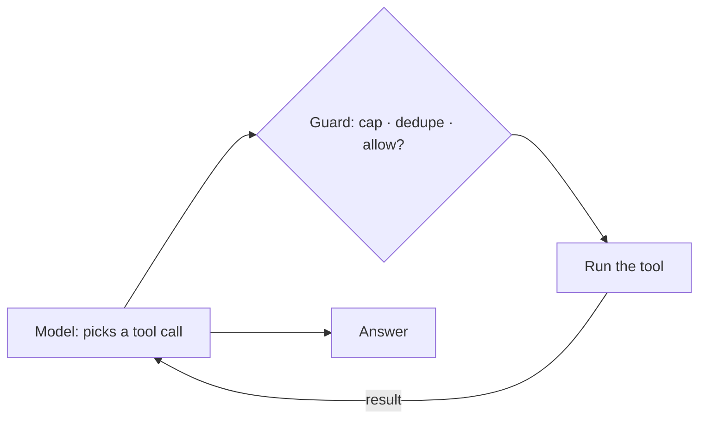
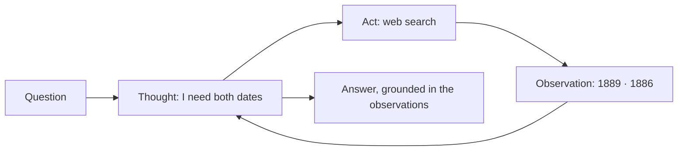
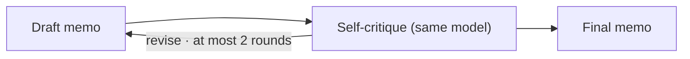
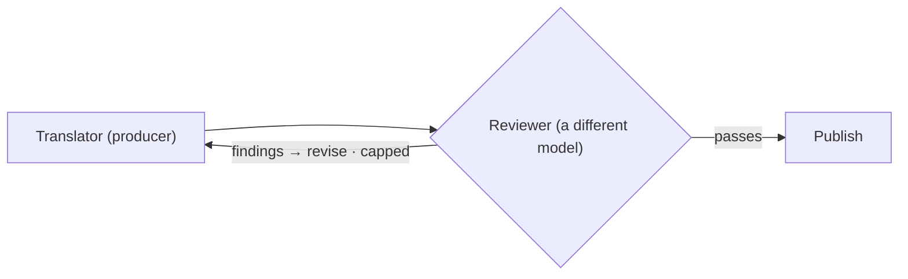
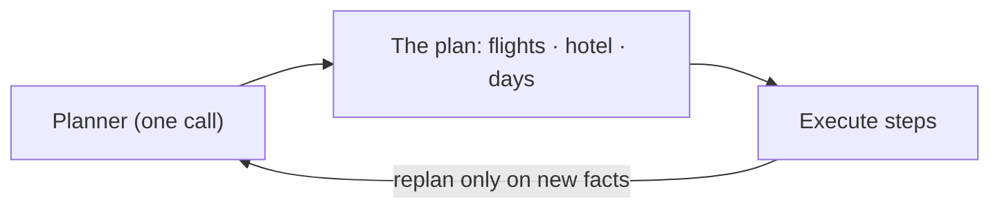
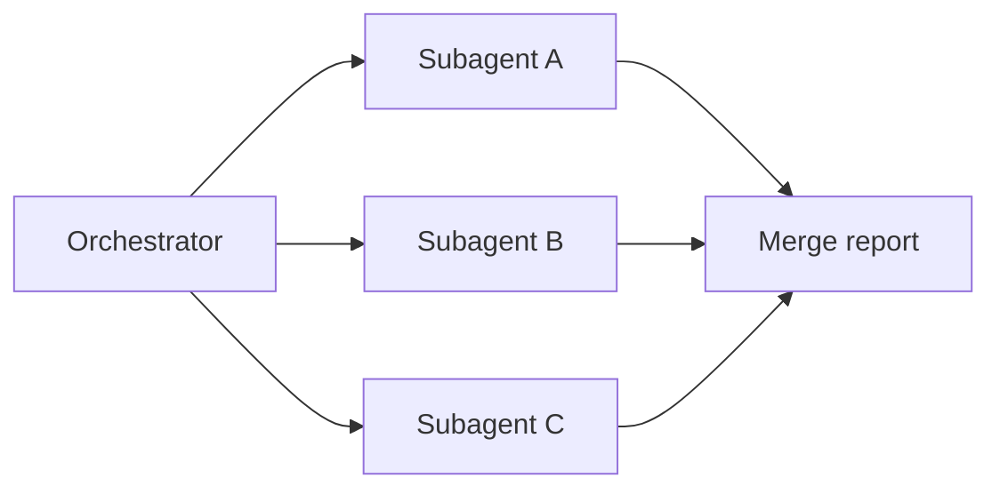




The [previous notes]() described systems in which code chooses every next step. Here we hand some of those choices to the model.
A pattern is **agentic** when the model decides at least one of three things: **what to do next**, **whether the work is good enough**, or **how to split the work up**.

We study six agentic patterns in increasing order of the control they hand over: a tool-use loop, ReAct, reflection, evaluator–optimizer, planning, and orchestrator–subagent.
The thread running through them is that **every decision handed to the model needs a fence around it**, and the fence is the part the engineer is responsible for.

By the end of these notes you should be able to:
- say which decision each agentic pattern hands to the model;
- describe each pattern with an example, when it helps, and how it fails;
- specify the fence (caps, budgets, independent judges) that each pattern needs;
- explain why a high-risk agent might deliberately use only one agentic pattern.



There are three kinds of decision a model can be given:

| The model decides... | In practice | Patterns |
|---|---|---|
| **What to do next** | Call a tool, look something up, or answer | Tool-use loop · ReAct |
| **Whether it is good enough** | Critique a draft, or be judged, and try again | Reflection · Evaluator–optimizer |
| **How to split the work** | Break a goal into steps or sub-tasks | Planning · Orchestrator–subagent |

This is also the order of these notes: from one model in a loop, to a model checking work, to a model organising other model calls.
Each step up hands over more control, so each needs a stronger fence.



This is the base pattern every other one builds on. The model's output is not prose but a **structured tool call**: a tool name and JSON arguments. Code validates the call, runs it, and hands the result back to the model, which decides what to do next.


A calendar assistant is asked to "_book 30 minutes with Priya and Arun next week_". The model calls `find_free_slots`, then `check_rooms` for the chosen slot, then `send_invite`.
A different request would produce a different sequence of calls, and that is precisely what makes this agentic rather than a workflow.


**When to use it.** When the steps cannot be known in advance, but every action can be expressed as a typed tool call.

**How it fails.** Runaway loops, the same call repeated, and unsafe actions. The fence sits in the middle of the diagram: a guard that **caps the number of steps**, **suppresses repeated identical calls**, and **checks whether this particular call is allowed**.
That last check is exactly [the Gatekeeper]() from the first notes.



**ReAct** (Yao et al., 2022) interleaves **reasoning** with **acting**: before each action, the model writes a short thought explaining what it is about to do, then acts, then observes the result.


"_Which is older, the Eiffel Tower or the Statue of Liberty?_" The model thinks that it needs both construction dates, searches for the Eiffel Tower (completed 1889), thinks again, searches for the Statue of Liberty (dedicated 1886), compares, and answers that the Statue of Liberty is older.


**Why it helps.** The visible trace makes the model's choices **inspectable**: when something goes wrong, you can read why the agent did what it did. It also tends to improve performance on multi-step questions.

**How it fails.** A thought is the model talking to itself. It is useful for debugging and **worthless as evidence**. A line like "_Thought: I verified this_" verifies nothing.
The final answer must be grounded in the **observations** (what the tools actually returned), not in the reasoning; we develop this in [Hallucination Checks]().



In **reflection**, the model reviews its own output, names what is missing or wrong, and revises it. Two well-known variants are **Self-Refine** (Madaan et al., 2023), which critiques and rewrites an output, and **Reflexion** (Shinn et al., 2023), which writes a lesson from a failed attempt into memory before retrying.


The model drafts a policy memo, then is asked to critique it ("_which claims are unsupported? what is missing for the CFO?_"), then rewrites it using the critique, stopping after two rounds.


**When to use it.** When a first pass reliably leaves gaps and a second look is cheap.

**How it fails.** The limitation is in the name: **the critic is the author**. It shares the author's blind spots, and models tend to approve their own work.
Cap the rounds, and when the stakes are high, prefer an **outside** check, which is the next pattern.



A **producer** drafts; a separate **evaluator** judges the draft against criteria fixed in advance and returns specific findings; the producer revises; repeat until the draft passes or a cap is reached.


A translator model drafts a translation. A reviewer model, ideally from a different model family, scores it against the company's style guide and glossary and lists specific problems. The translator revises only what was flagged.


**What makes it different from reflection** is **independence**. The evaluator did not write the work, reads it with fresh context, and judges it against criteria that were fixed before the work began.
An evaluator that is the same model, merely prompted to "_be strict_", still has the same blind spots.

**How it fails.** A judge that is not independent, criteria that move, or a loop with no cap. Judges are themselves models with known biases, which we study in [LLM as a Judge]().



ReAct decides one step at a time. **Planning** decides the shape of the whole job **first**, then executes the steps. Plan-and-Solve (Wang et al., 2023) and ReWOO (Xu et al., 2023) showed that planning up front can save a large share of the tokens step-by-step reasoning would use.


"_Plan three days in Kyoto on a mid-range budget._" The planner writes: book flights; book a hotel near Kyoto Station; day 1 Higashiyama; day 2 Arashiyama; day 3 Fushimi Inari and Nara. An executor carries out each step.
If the flights turn out to be sold out for those dates, that is **new information**, and the plan is revised.


Notice the dependencies: the hotel depends on the flight dates, while the three days do not depend on each other. **A good plan is a small graph, not a list**, and independent steps can run in parallel.

**How it fails.** Plans grow and go stale. Bound the size of the plan, and **replan on new facts, not by habit**.



An **orchestrator** model splits the work at run time and hands each piece to a **subagent** with its own context, then merges the results. Anthropic calls this pattern _orchestrator–workers_.

It looks like [map-reduce](), with one difference: here **a model decides how many sub-tasks there are and what each one is**.


"_How are our three main competitors pricing their enterprise tier?_" The orchestrator decides which competitors to cover and sends one subagent per competitor, each with only that brief.
Each subagent has its own clean context and never sees the others' pages, which keeps contexts small and stops one bad source from contaminating everything ([context isolation]()).


**How it fails.** This is the most expensive pattern: coordination cost, duplicated work and budget blow-outs. Cap the number of subagents and the total budget, and make the merge step check for overlap and contradiction.



The two reference agents use these patterns very differently, and the reason is instructive.

| Pattern | Where it appears | Why there |
|---|---|---|
| **Tool-use loop** | CSA: propose ⇄ execute | The steps of a support conversation can't be scripted, but every action is a typed call that can be checked |
| **ReAct** | RA: direct answers | Open web questions; the trace makes tool choices debuggable |
| **Reflection** | RA: after each research round | First rounds leave gaps; follow-ups are fitted to the remaining budget |
| **Evaluator–optimizer** | RA: synthesise → independent audit → revise | The rubric is fixed; the judge must be a different model |
| **Planning** | RA: a plan of sub-questions with dependencies | Research has structure; plan size is capped |
| **Orchestrator–subagent** | RA: one research node per sub-question, in parallel | Sub-questions are unknown until planned |

The support agent uses **one** agentic pattern because it **moves money**. In its graph, the model decides only two things: which tool to call with which arguments (fenced by the Gatekeeper and a loop governor), and the **words** of the final reply, never the facts, which a [hallucination guard]() checks against what the tools returned.
That is the whole agentic surface of an agent that moves money: small on purpose, and fenced on both sides.

The research agent uses **all six** because it only **reads**. Its blast radius is bounded, so it can afford to hand the model planning, delegation and self-review, inside budgets and with a final verdict decided by code.



The practical summary of this chapter is a table: every agentic loop in the reference agents, and the fence around it. Each fence is **configuration**, and each one shows up in the trace when it fires.

| Agentic pattern | The fence |
|---|---|
| Tool-use loop (CSA) | At most 5 iterations · duplicate suppression · the Gatekeeper on every call |
| ReAct (RA answers) | At most 6 steps · the answer grounded against tool results |
| Reflection (RA) | A maximum number of rounds · follow-ups trimmed to the searches left |
| Evaluator–optimizer (RA) | The judge is not the writer · capped gap-filling · the verdict decided by code |
| Planning (RA) | A maximum plan size · budgets on searches, fetches, tokens and seconds |
| Orchestrator–subagent (RA) | Bounded concurrency · untrusted pages read only by a quarantined extractor |

If you cannot fill in the right-hand column for your own agent, you do not yet have an agent; you have a bill waiting to happen. We build these fences properly in [Guardrails, Loop Control & State]().



Why does the support agent use only one agentic pattern, while the research agent uses all six?



Because **blast radius sets the count** ([Levels of Automation]()).
The support agent moves money, so every extra decision handed to the model would need another fence around a payment. The research agent only reads, so it can delegate planning, decomposition and self-review to the model, within budgets and an independent audit.



- A pattern is **agentic** when the model decides **what to do next**, **whether the work is good enough**, or **how to split it**.
- Six patterns, in increasing order of delegated control: **tool-use loop, ReAct, reflection, evaluator–optimizer, planning, orchestrator–subagent**.
- Self-critique shares the author's blind spots; an **independent** evaluator does not.
- **Blast radius sets how many patterns to use**, and **every loop needs a fence** held in configuration.

💡 _An agentic pattern is a decision you hand to the model. The fence is the part you're responsible for._



Concepts used in these notes are developed in the other courses on this site:

- NLP: [Large Language Models]()
- NLP: [Reinforcement Learning from Human Feedback (RLHF)]()
- NLP: [Self-Attention]()



- Yao et al., [_ReAct: Synergizing Reasoning and Acting in Language Models_](https://arxiv.org/abs/2210.03629) (2022).
- Shinn et al., [_Reflexion: Language Agents with Verbal Reinforcement Learning_](https://arxiv.org/abs/2303.11366) (2023).
- Madaan et al., [_Self-Refine: Iterative Refinement with Self-Feedback_](https://arxiv.org/abs/2303.17651) (2023).
- Wang et al., [_Plan-and-Solve Prompting_](https://arxiv.org/abs/2305.04091) (2023).
- Xu et al., [_ReWOO: Decoupling Reasoning from Observations for Efficient Augmented Language Models_](https://arxiv.org/abs/2305.18323) (2023).
- Anthropic, [_Building Effective Agents_](https://www.anthropic.com/research/building-effective-agents) (2024): orchestrator–workers and evaluator–optimizer, with guidance on when to use them.


<!-- nav-panel:start -->

<a href="">Previous: Workflow Design Patterns</a>
<a href="">Next: Retrieval-Augmented Generation</a>

<!-- nav-panel:end -->
