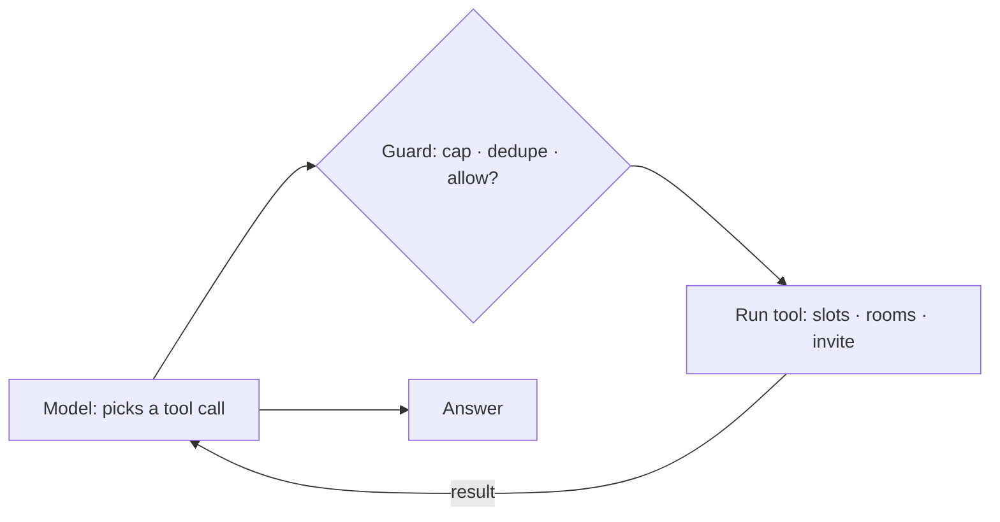
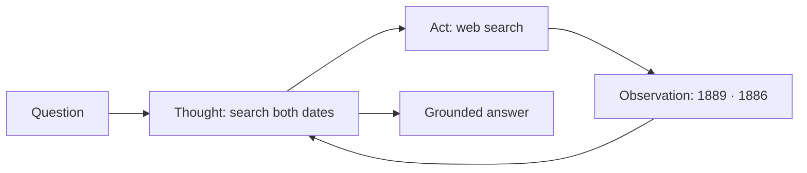
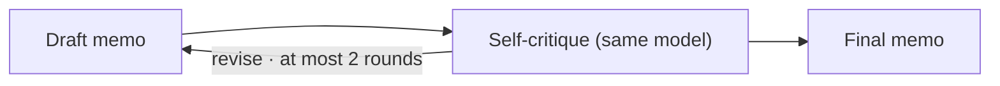
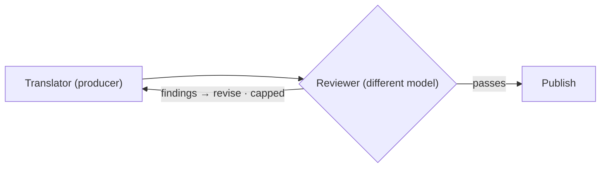
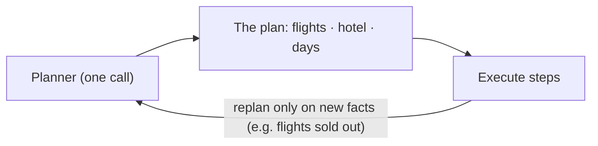
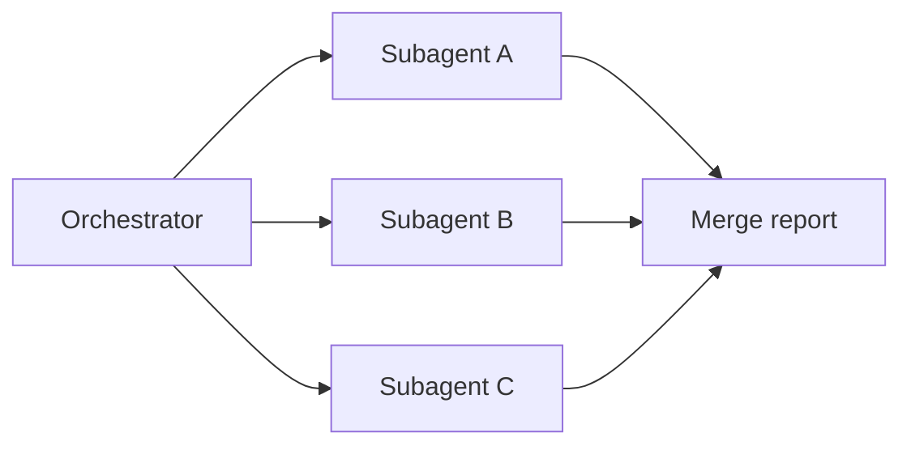




📘 The flip side of [workflows](). A pattern is **agentic** when the model decides **at least one** of:

| The model decides... | Meaning | Patterns |
|---|---|---|
| ➡️ **What to do next** | Call a tool, look something up, or answer | Tool-use loop · ReAct |
| ✅ **Is it good enough?** | Critique the draft, or be judged, and retry | Reflection · Evaluator–optimizer |
| 🧩 **How to split the work** | Break the goal into steps or sub-tasks | Planning · Orchestrator–subagent |

💡 **Each step up hands the model more control, so each needs a stronger fence.**



Simplest first; 👉 **each pattern adds one more decision the model makes**:

1. 🛠️ **Tool-use loop**: the model chooses tools
2. 💭 **ReAct**: ...and reasons out loud between tools
3. 🪞 **Reflection**: ...and checks its own work
4. ⚖️ **Evaluator–optimizer**: ...and is checked by another model
5. 🗺️ **Planning & decomposition**: ...and plans the whole job up front
6. 🧑‍🤝‍🧑 **Orchestrator–subagent**: ...and coordinates other model calls



The model picks a tool call; code runs it; the result goes back; repeat.

- 📌 **Example**: "_Book 30 minutes with Priya and Arun next week._" The model calls `find_free_slots`, then `check_rooms`, then `send_invite`. A different request produces a different sequence: that's what makes it agentic.
- ✅ **Use when**: the steps can't be known in advance, but every action is a **typed tool call** (a name + JSON arguments, not prose).
- ⚠️ **Watch out**: runaway loops, repeated calls, unsafe actions. **Cap the steps, de-duplicate, gate every call**: the guard in the middle is exactly [the Gatekeeper]().



**Reason, act, observe, repeat**: the model writes its reasoning between every action (Yao et al., 2022).

- 📌 **Example**: "_Which is older, the Eiffel Tower or the Statue of Liberty?_" Think → search "Eiffel Tower completed" (1889) → search "Statue of Liberty dedicated" (1886) → compare → the Statue of Liberty is older.
- ✅ **Use when**: open questions needing several lookups, where the reasoning trace helps you debug.
- ⚠️ **Watch out**: **a thought is not evidence.** It's the model talking to itself. Check the final answer against what the tools returned.

[Read more about grounding and Hallucination Checks]()



The model reviews its own output, names what is missing or wrong, and revises (Reflexion, Shinn et al., 2023; Self-Refine, Madaan et al., 2023).

- 📌 **Example**: draft a policy memo; critique it ("_which claims are unsupported? what's missing for the CFO?_"); rewrite. Two rounds.
- ✅ **Use when**: the first pass reliably leaves gaps, and a second look is cheap.
- ⚠️ **Watch out**: **the critic is the author.** It shares the author's blind spots and tends to approve its own work. Cap the rounds; prefer an outside check when stakes are high.



A producer drafts; an **independent** evaluator judges it; revise until it passes.

- 📌 **Example**: a translator model drafts; a reviewer model, ideally a different model family, scores it against the style guide and glossary and returns specific findings; the translator revises only what was flagged.
- ✅ **Use when**: clear criteria exist, and quality matters more than speed.
- ⚠️ **Watch out**: **the judge must be independent**: a different model, fresh context, criteria fixed before the work began. Cap the revisions.

[Read more about LLM as a Judge]()



The model breaks the goal into steps **up front**, then the steps are executed. ReAct decides one step at a time; planning decides the shape of the whole job first (Plan-and-Solve, Wang et al., 2023; ReWOO, Xu et al., 2023), which saves a large share of tokens.

- 📌 **Example**: "_Plan three days in Kyoto, mid-range budget._" Book flights; book a hotel near Kyoto Station; day 1 Higashiyama, day 2 Arashiyama, day 3 Fushimi Inari and Nara.
  The hotel depends on the flight dates; the days don't depend on each other. **A good plan is a small graph, not a list.**
- ✅ **Use when**: multi-step goals with a knowable structure.
- ⚠️ **Watch out**: plans grow and go stale. Bound the plan's size; **replan on new facts, not by habit**.



An orchestrator splits the work **at run time**; subagents each take one piece. It looks like [map-reduce](), except **a model decides how many sub-tasks there are and what each one is**.

- 📌 **Example**: "_How are our three main competitors pricing their enterprise tier?_" One subagent per competitor, each with only its own brief and its own clean context, so one bad source can't contaminate everything.
- ✅ **Use when**: the sub-tasks can't be predicted until the problem is seen, and they're independent.
- ⚠️ **Watch out**: the most expensive pattern. Coordination cost, duplicated work, budget blow-out. Cap the subagents and the total budget; give subagents **narrow, isolated context**.

[Read more about context isolation]()



👉 **CSA uses one pattern because it moves money. RA uses all six because it reads.**

| Pattern | Where in our code | Why there |
|---|---|---|
| **Tool-use loop** | CSA propose ⇄ execute | Steps unknown; every call can be gated |
| **ReAct** | RA direct answer | Open web questions; debuggable trace |
| **Reflection** | RA reflect, after each research round | First rounds leave gaps; budget-fitted |
| **Evaluator–optimizer** | RA synthesize → audit → revise | Rubric = fixed criteria; different judge |
| **Planning** | RA plan DAG | Research has structure; plan size capped |
| **Orchestrator–subagent** | RA research nodes | Sub-questions unknown until planned |

**CSA, agentic lens**: the model decides only two things:
1. **propose ⇄ execute**: the tool and its arguments, fenced by the Gatekeeper and the loop governor.
2. **finalize**: the _words_ of the reply, never the facts; a hallucination guard checks them against what the tools returned.

💡 The agentic surface of an agent that moves money: **small, and fenced on both sides.**

**RA, agentic lens**: planning (plan DAG) → subagents (research node ×N) → reflection (reflect) → evaluator–optimizer (synthesize → independent audit → revise), with the final verdict decided by code.
Wide model autonomy, inside a frame the model can't move.



| Agentic pattern | The fence, in configuration |
|---|---|
| Tool-use loop · CSA | ≤ 5 iterations · duplicate suppression · Gatekeeper on every call |
| ReAct · RA answer | ≤ 6 steps · grounding against tool results |
| Reflection · RA | Max rounds · follow-ups trimmed to the searches left |
| Evaluator–optimizer · RA | Judge ≠ writer · capped gap fill · verdict by code |
| Planning · RA | Max plan size · budgets on searches, fetches, tokens, seconds |
| Orchestrator–subagent · RA | Bounded concurrency · quarantined page reader |

Every fence is configuration, and every fence shows up in the trace when it fires.

💡 **No fence, no agent. Just a bill waiting to happen.**

[Read more about Loop Control]()



Why does the customer support agent use only one agentic pattern, while the research agent uses all six?



**Blast radius sets the count** ([Levels of Automation]()).
The CSA moves money: every extra decision handed to the model is one more thing that would need a fence around a payment.
The RA only reads the web: its blast radius is bounded, so it can hand the model planning, delegation and self-review, inside budgets and a code-decided verdict.



- 🖊️ **Agentic** = the model decides what next, whether it's good enough, or how to split the work.
- 🪜 **Six patterns**, from a tool loop to an orchestrator with subagents.
- 💥 **CSA uses one, RA uses six.** Blast radius sets the count.
- 🚧 **Every loop has a fence in config**: steps, budgets, judges, verdicts.

💡 _An agentic pattern is a decision you hand to the model. The fence is the part you're responsible for._


_Reference_:
- ReAct: Synergizing Reasoning and Acting in Language Models, Yao et al., 2022, https://arxiv.org/abs/2210.03629
- Reflexion: Language Agents with Verbal Reinforcement Learning, Shinn et al., 2023, https://arxiv.org/abs/2303.11366
- Self-Refine: Iterative Refinement with Self-Feedback, Madaan et al., 2023, https://arxiv.org/abs/2303.17651
- Plan-and-Solve Prompting, Wang et al., 2023, https://arxiv.org/abs/2305.04091
- ReWOO: Decoupling Reasoning from Observations, Xu et al., 2023, https://arxiv.org/abs/2305.18323
- Building Effective Agents, Anthropic, Dec 2024, https://www.anthropic.com/research/building-effective-agents

<!-- nav-panel:start -->

<a href="">Previous: Workflow Design Patterns</a>
<a href="">Next: Retrieval-Augmented Generation</a>

<!-- nav-panel:end -->
