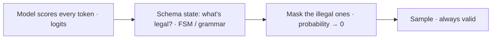
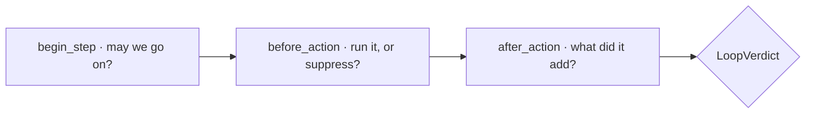
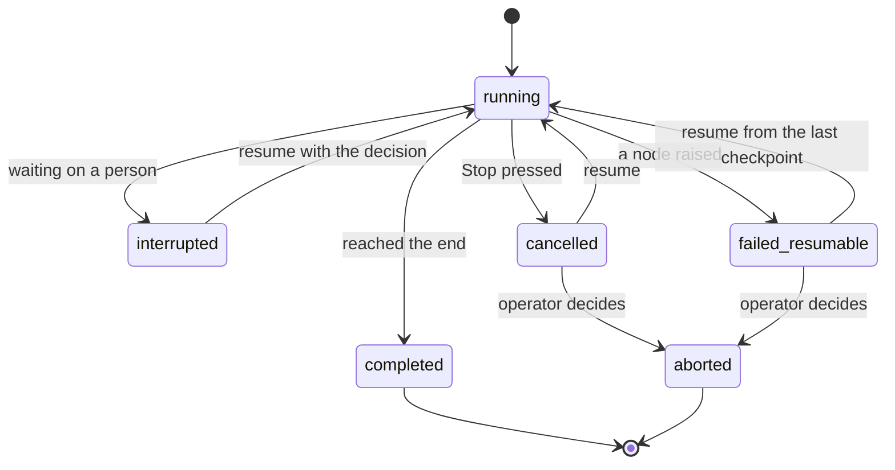




📘 Each failure has its own control:

| Failure | Looks like | Control |
|---|---|---|
| 📐 **Wrong shape** | A missing field, broken JSON, a string where a number belongs | **Output guardrails** (type safety) |
| 🔁 **Too long, in circles** | The same call five times; no progress; the budget gone | **Loop control** |
| 💥 **Dies halfway** | A crash, a deploy, a Stop: mid-refund | **State management** |

Why one episode? They share one object: the loop's counters and its memory of what it already tried are part of the **checkpointed state**.

💡 **Bound what it says, how long it runs, and what survives when it stops.**



Two different guarantees that are often confused:

| | **Validate** · Pydantic | **Constrain** · Outlines, LMQL |
|---|---|---|
| How | The model writes anything; a schema checks it **afterwards** | Invalid tokens are **masked before sampling** |
| Bad output | Rejected, repaired or retried (each retry is a round trip) | **Unrepresentable** |
| Requires | Any model, any API | Your hands on the decoder (logits) |

💡 **Validate when you can't control the decoder. Constrain when you can.**

**How constrained decoding works**:



- **Outlines** (Willard & Louf, 2023) compiles a regex or JSON Schema into a finite-state machine once; each step is a lookup.
- **LMQL** (Beurer-Kellner et al., PLDI 2023) is a query language: prompts with typed holes and constraints, enforced while decoding.

👉 Both need access to the logits on **every token**: you run the model yourself, or a server exposes guided decoding.
A hosted chat endpoint that returns only text (and rejects guided-decoding fields) can only be **validated**, which is why our hosted path validates and a local llama.cpp path constrains with a grammar. **The mode is configuration, not an assumption.**



```python
DollarAmount = Annotated[Decimal, WithJsonSchema({"type": "number"})]

class RefundArgs(BaseModel):
    """Arguments for issuing a refund."""
    order_id: int = Field(description="The order to refund")
    amount: DollarAmount = Field(description="the full order total, confirmed first")
    reason: str = Field(default="", description="Why the refund is being issued")

parameters = RefundArgs.model_json_schema()   # 1. what the model is shown
args = RefundArgs.model_validate_json(raw)    # 2. what the model sent, checked
                                              # 3. a typed object for the rest of the code
```

From one class: the **schema** for the model, **validation** of its reply, and a **typed object** for code. Money is a `Decimal`, never a float, so $137.32 stays $137.32.

**Three guardrail modes** (one setting):

| Mode | Behaviour |
|---|---|
| **reject** | Validate; on failure, fail loudly. Simple and honest. |
| **auto_repair** (ours) | Validate; then ≤ 2 **mechanical** fixes: strip a code fence, cut to the outer braces, drop a trailing comma. Never guesses. |
| **constrained** | Send the schema to a decoder that enforces it, only where the backend can. |

💡 **Repair the syntax, never the meaning.**

**Pydantic in the CSA**:

| Where | Model | What it guarantees |
|---|---|---|
| Tool arguments | `RefundArgs` · `CancelArgs` · ... | Every proposed call validated **before** [the Gatekeeper]() |
| The reply | `CustomerResponse` | A non-empty reply, ≤ 4,000 characters |
| Graph state | `AgentState` | A wrong shape fails where it happened |
| Configuration | pydantic-settings classes | A config typo fails at start-up, not mid-refund |
| Loop memory | `LoopState` | Checkpointed with the turn |

In the **RA**, every model call goes through one structured door: each role has a schema, every answer is validated, tokens are charged to the budget. The **Contract** is frozen and hashed at approval, and the plan is validated for cycles before any search,
so "_the run used what you approved_" is checkable.

💡 **Pydantic constrains the shape. The [hallucination guard]() constrains the facts.**



Every loop is governed by **one** object, and every check answers in **one** shape, a verdict:



| Verdict | Meaning |
|---|---|
| **continue** | Go round again |
| **suppress** | Skip this repeat, go on |
| **finalize** | Answer from what you have |
| **abort** | Stop, no answer |
| **pause** | Wait for a person |

💡 **One authority, one verdict, one trace card: a rule is written once.**

**Iteration limits and resource budgets**: hard caps, enforced **before** the spend, not after.
- 🔢 **Step cap** per agent, from its own config (CSA tool loop 5 · RA answer 6).
- 💰 **Budgets**: tokens, cost, tool calls, seconds. **Reserve → commit / release**, so four parallel workers can't each spend "the last search".
- ⏱️ **Deadline**: each call gets the time **left**; a call still running at the deadline is cancelled.



**Four tiers of duplicate detection**, cheapest first:

| Tier | Catches |
|---|---|
| **Exact** | Identical arguments |
| **Canonical** | `5 = 5.0 = "5"`, key order, case, whitespace |
| **Semantic** | ≥ 0.92 similar to an action that already **failed** |
| **Cycle** | A→B→A→B, repeating as a block |

The verdict is **suppress**, and the model is told why: "_You already called this and it returned: ... Use that result rather than calling it again._"

💡 **Don't just block the repeat. Tell the model what it already has.**

**Goal-distance convergence**: not "_how many steps?_" but "_is each step still adding anything?_"

- 📉 **Gain per step** = 1 − similarity to the evidence so far. 3 steps under 0.05 → **finalize**.
- 🎯 **The agent's own "done"**: e.g. for the RA, are the rubric items covered?
- 📊 **Historical baseline**: far longer than this agent's usual turn (z > 3 over its last 200)? A **flag**, not a stop.

💡 **Stop when it stops learning, not only when it runs out of steps.**

| Mechanism | CSA | RA |
|---|---|---|
| Step cap | 5 tool iterations | 6 answer steps · max rounds · gap fills |
| Budgets | Tokens · cost · deadline | Searches · fetches · tokens · seconds, reserved |
| Duplicates | A repeated refund is suppressed | A repeated query is suppressed |
| Convergence | Plateau → answer now | Plateau + rubric coverage |
| Baseline | Flag unusually long turns | Flag unusually long runs |

👉 One governor for both; only the caps differ, from each agent's config.



Every guardrail above has **memory**. That memory is checkpointed with the run, so a resume keeps every fence:

- 🔢 **Step count** continues: no fresh step cap after a restart.
- ⏱️ **Clock and budget** continue: no fresh deadline.
- 🔁 **Actions tried**: a refused refund is still a duplicate; no second attempt.

💡 **Without durable state, a restart quietly resets every fence.**

**How state is persisted**:
- 💾 **Per node**: state saved after every node; resume re-runs only the unfinished one.
- 🧵 **Per turn**: one thread per turn, so a stuck turn never blocks the next.
- 🔐 **Encrypted**: checkpoints hold customers' words; encrypt them, and purge completed threads after a retention window (30 days).
- 📇 **Indexed**: a run registry records status, where it stopped and what it waits on.





👉 Only **completed** and **aborted** are ends. Everything else can be picked up again.

| Control | What it does |
|---|---|
| ⏹️ **Stop** | Cancel now; every checkpoint stays. A stop report: where, how far, what next. |
| ▶️ **Resume** | Re-run only the unfinished node. Re-bind the verified customer first. |
| ⛔ **Abort** | Decide not to go on. Nothing undone: the record is kept. |

**Why resume is safe**: a re-run node must be safe to run twice.
1. **Idempotent effects**: a committed refund replays its recorded result; it **never pays twice**.
2. **Clean interrupts**: the node that waits does nothing else; it re-runs whole on resume.
3. **Reviewer decides**: a paused refund resumes on a reviewer's decision, never automatically at start-up.

💡 **Stop is safe, resume is exact, abort is a decision.** Durability isn't saving state; it's making every re-run harmless.

[Read more about Resilience]()



An agent crashes after 4 of its 5 allowed tool iterations, including one refused refund. After the restart, how many iterations does it get, and can it retry the refund?



**One more iteration, and no retry.** The loop state is checkpointed with the run, so the step count, clock and budget continue,
and the refused refund is still recorded as a duplicate. A restart that reset these would quietly remove every fence.



- 📐 **Validate when you can't constrain**; constrain where the backend allows.
- 🧱 **Pydantic everywhere**: tool args, replies, graph state, config, the RA contract.
- 🎛️ **One governor**: step caps, budgets, four duplicate tiers, convergence.
- 💾 **Durable state keeps the fences**: stop, resume and abort, safely.

💡 _A guardrail that forgets on restart isn't a guardrail._


_Reference_:
- Pydantic documentation, https://docs.pydantic.dev/
- Willard & Louf, Efficient Guided Generation for Large Language Models (Outlines), 2023, https://arxiv.org/abs/2307.09702
- Beurer-Kellner, Fischer & Vechev, Prompting Is Programming: A Query Language for LLMs (LMQL), PLDI 2023, https://arxiv.org/abs/2212.06094
- LangGraph persistence, https://langchain-ai.github.io/langgraph/concepts/persistence/

<!-- nav-panel:start -->
<div style="display:flex;justify-content:space-between;align-items:center;width:100%;gap:16px;">
<span><a href="">Previous: Retrieval-Augmented Generation</a></span>
<span style="margin-left:auto;"><a href="">Next: Context Management</a></span>
</div>
<!-- nav-panel:end -->
