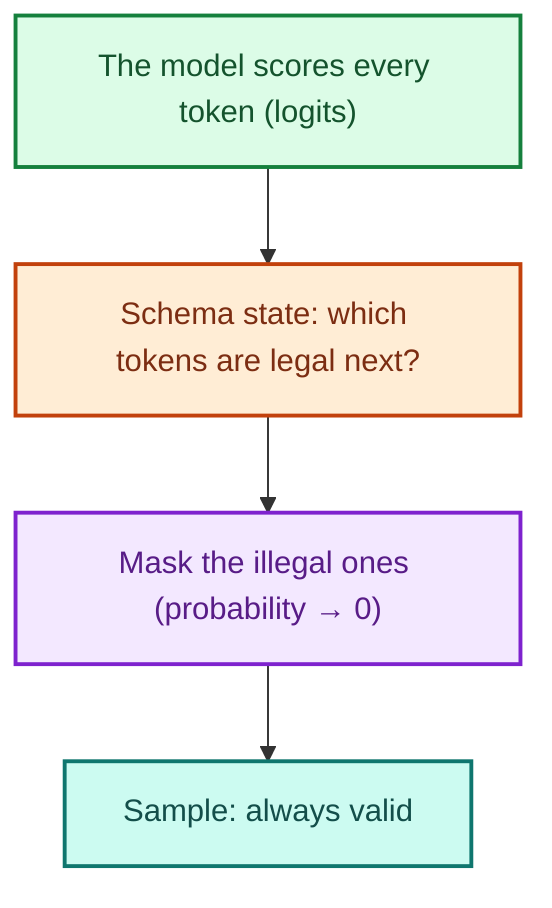
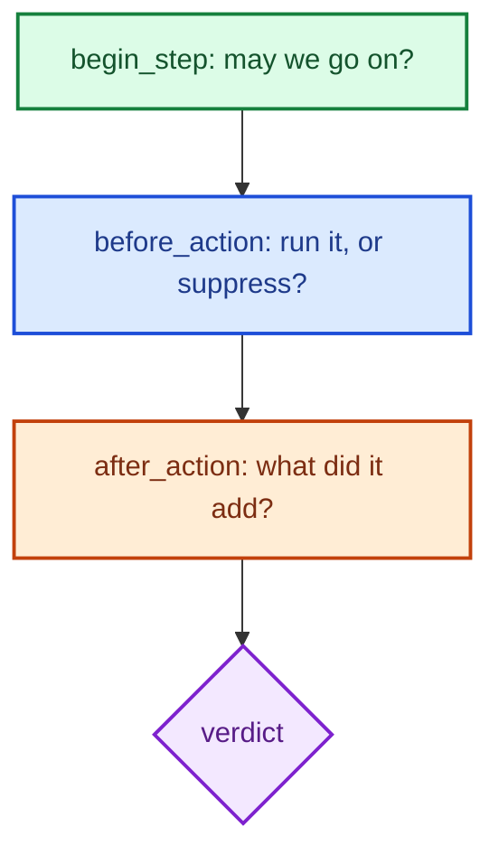
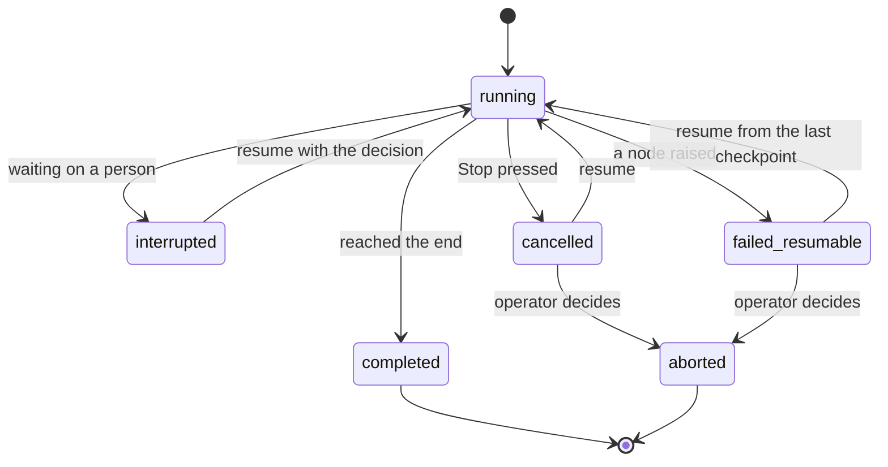




An agent can go off the rails in three distinct ways. It can produce output of the **wrong shape**: a tool call with a missing field, JSON that doesn't parse, an amount written as a string. It can run **too long or in circles**: the same call five times, a loop that never converges, a budget that quietly disappears.
Or it can **die halfway**: a crash, a deployment or a person pressing Stop in the middle of a refund.

Each failure has its own control: **output guardrails**, **loop control** and **state management**. We treat them in one chapter because they share one object.
The counters and memory that loop control relies on must survive a restart, or the controls silently reset. A guardrail that forgets on restart is not a guardrail.

By the end of these notes you should be able to:
- distinguish validating a model's output after generation from constraining it during decoding, and choose between them;
- use a schema library such as Pydantic to make the shape of tool calls and replies a checked contract;
- design loop control with step caps, budgets, duplicate detection and convergence checks;
- explain how checkpointed state makes stop, resume and abort safe, including for actions that move money.



There are two quite different ways to guarantee the shape of a model's output, and they are often confused.

**Validating after generation.** The model writes whatever it writes; afterwards, you parse the result against a schema. If it fails, you reject it, repair it, or ask again.
This works with any model and any API, but each retry costs a full round trip and adds to tail latency. This is what libraries such as **Pydantic** do.

**Constraining during decoding.** At every token, the tokens that would break the schema are removed before sampling from the [softmax](), so invalid output is not merely unlikely; it is **unrepresentable**. This is what **Outlines** and **LMQL** do, as do grammar-based decoders such as llama.cpp's.



Outlines (Willard & Louf, 2023) compiles a regular expression or JSON Schema into a **finite-state machine** once, so that at each step the set of legal tokens is a lookup rather than a search.
LMQL (Beurer-Kellner et al., 2023) is a query language in which you write a prompt with typed "holes" and constraints, and the runtime enforces them while decoding.

Both share one requirement: you must be able to touch the model's **logits on every token** (the scores the [softmax]() turns into probabilities). That means running the model yourself, or using a server that exposes guided decoding.
A hosted chat API that returns only text gives you no logits, and some hosted endpoints reject guided-decoding parameters outright. In those cases validation is the only option.
The course's agents therefore validate on the hosted path and constrain only on a local path where a grammar is available, with the choice held in configuration rather than assumed.

**Validate when you can't control the decoder. Constrain when you can.**


[Read more about Softmax]()  
[Read more about Tokenization]()



A Pydantic model is a schema written as a Python class: field types, constraints and descriptions. Here is the real argument schema for the support agent's refund tool:

```python
DollarAmount = Annotated[Decimal, WithJsonSchema({"type": "number"})]

class RefundArgs(BaseModel):
    """Arguments for issuing a refund."""
    order_id: int = Field(description="The order to refund")
    amount: DollarAmount = Field(description="the full order total, confirmed first")
    reason: str = Field(default="", description="Why the refund is being issued")

parameters = RefundArgs.model_json_schema()   # 1. the schema the model is shown
args = RefundArgs.model_validate_json(raw)    # 2. what the model sent, checked
                                              # 3. a typed object for the rest of the code
```

From one class we get three things. First, the **JSON Schema** the model is shown as the tool's parameters. Second, **validation** of what the model sends back: an `order_id` that isn't an integer, or a missing amount, fails before anything runs.
Third, a **typed object** for the rest of the code. Note `DollarAmount`: internally a `Decimal`, advertised to the model as a plain number. Money is never a floating-point number, so $137.32 stays exactly $137.32.

**Repair the syntax, never the meaning.** When validation fails, what should happen? The platform offers three modes, chosen in configuration.
In **reject** mode, a failure simply fails, loudly. In **auto-repair** mode (the default), the guard tries at most two **mechanical** fixes: stripping a Markdown code fence, cutting to the outermost braces, dropping a trailing comma.
Anything cleverer would be guessing what the model meant, which is exactly the failure the guard exists to prevent. In **constrained** mode, the schema is sent to a decoder that enforces it, where the backend allows.

**Where schemas appear.** In the support agent, schemas are not just for the model's final output:

| Where | Schema | What it guarantees |
|---|---|---|
| Tool arguments | `RefundArgs`, `CancelArgs`, ... | Every proposed call is validated **before** [the Gatekeeper]() sees it |
| The customer reply | `CustomerResponse` | A non-empty reply of at most 4,000 characters |
| Graph state | `AgentState` | A node returning the wrong shape fails where it happened, not three nodes later |
| Configuration | Settings classes | A typo in the configuration fails at start-up, not mid-refund |
| Loop memory | `LoopState` | The loop's memory is checkpointed with the turn (Part 3) |

The research agent goes further: every model call passes through a single structured door, with a schema per role and tokens charged to the run's budget.
Its **contract** (brief, rubric and budget) is frozen and hashed when you approve it, and its plan is validated for dependency cycles before any search runs, so "_the run used what you approved_" is something you can check, not merely a promise.

**A schema constrains the shape of a reply. The [hallucination check]() constrains its facts.**



The second failure mode is a loop that runs too long. Early agent code tends to grow its controls piecemeal: a step cap in one place, a duplicate check in another, a budget in one agent but not the next.
The cleaner design is a single **loop governor** that every check goes through, answering every question in the same shape, a **verdict**:



| Verdict | Meaning |
|---|---|
| **continue** | Go round again |
| **suppress** | Don't run this one action (it repeats an earlier one), but keep going |
| **finalize** | Stop acting, and answer from what you have |
| **abort** | Stop without an answer |
| **pause** | Wait for a person |

Because every mechanism speaks through one object, every graph can route on the verdict with one function, and every intervention shows up in the trace in one place. A rule is written once.

**Iteration limits, budgets and deadlines.** The crude caps still matter, provided they are enforced **before** the spend rather than after:
- a **step cap** per agent, from its own configuration (for example, 5 tool iterations for the support agent);
- **budgets** for tokens, cost, tool calls and wall-clock time. When work runs in parallel, use **reserve → commit / release**: a worker reserves before spending, so four parallel workers cannot each see "_one search left_" and spend four;
- a **deadline** passed down to each model call as the time remaining, with any call still running at the deadline cancelled rather than merely reported late.



Step caps stop a runaway loop eventually. Two subtler mechanisms stop it **early**.

**Duplicate detection** looks for repeated actions in four tiers, cheapest first:

| Tier | Catches | Example |
|---|---|---|
| **Exact** | Byte-identical arguments | The same call, twice |
| **Canonical** | The same arguments written differently | `5`, `5.0` and `"5"`; different key order or case |
| **Semantic** | An action at least 0.92 similar to one that already **failed** | The model retrying its own failed idea in new words |
| **Cycle** | A block of actions repeating | A → B → A → B |

The verdict for a duplicate is **suppress**, not abort, and the model is told why in words it can use: "_You already called this and it returned: ... Use that result rather than calling it again._"
Most loops end themselves once the model sees what it already has.

**Convergence** asks a different question: not "_how many steps?_" but "_is each step still adding anything?_" One measure is the **gain** of a step,

\[\text{gain} = 1 - \max_{e \in \text{evidence so far}} \text{sim}(\text{new result}, e)\]

A step that brings back something new has high gain; one that returns the same rows or the same page has gain near zero. Three steps in a row with gain below 0.05 is a plateau, and the verdict is **finalize**: answer from what you have, before the step cap would have stopped the loop with nothing more to show.
Agents can also supply their own sense of "_done_" (for the research agent, whether the rubric's items are covered), and a historical baseline can **flag** a turn that is far longer than usual (as a flag, not a stop).

| Mechanism | Support agent (CSA) | Research agent (RA) |
|---|---|---|
| Step cap | 5 tool iterations | 6 answer steps; capped rounds and gap fills |
| Budgets | Tokens, cost, deadline | Searches, fetches, tokens, seconds; reserved |
| Duplicates | A repeated refund is suppressed | A repeated query is suppressed |
| Convergence | Plateau → answer now | Plateau plus rubric coverage |

The support agent's loop is short and expensive per step (it can move money), so tight caps and duplicate suppression matter most: a repeated `process_refund` is the classic runaway.
The research agent's loop is long, cheap per step and parallel, so reserved budgets and convergence matter most. Both use the same governor; only the caps differ.



Every mechanism in Part 2 has memory: how many steps were taken, how much budget is spent, which actions were already tried and what they returned. If that memory lives only in a running process, a crash or a restart **quietly resets every fence**: a fresh step cap, a fresh deadline, and a refused refund that is no longer recognised as a duplicate.

The fix is to make the loop's memory part of the agent's state and **checkpoint it after every step**. When a run resumes, the step count continues, the clock and budget continue, and an action that was refused or already completed is still recognised.

**How state is persisted** in the course's platform:
- **Per node.** The graph is compiled with a checkpointer, so the full state is saved after every node. A failed node leaves the run resumable from exactly that node.
- **Per turn.** Each customer turn is its own thread, so a turn that failed or is waiting for a person never blocks the next one.
- **Encrypted, with retention.** Checkpoints contain customers' words, so they are encrypted at rest, and completed threads are purged after a retention window (30 days). Keeping checkpoints forever means keeping customers' words forever.
- **Indexed.** A small run registry records each run's status, where it stopped and what it is waiting for, so "_which runs need attention?_" can be answered without decoding every checkpoint.



With durable state, a run has a well-defined lifecycle:



Only **completed** and **aborted** are endings; every other state can be picked up again. Three controls are the same in every durable agent.
**Stop** cancels immediately; every checkpoint stays, and the person sees a report of where it stopped and how far it got. **Resume** re-runs only the node that didn't finish, after re-establishing anything that isn't part of the graph state (such as which customer is verified).
**Abort** is the decision not to go on; nothing is undone at that point, and the record is kept.

**Why resume is safe, even for money.** A node that is re-run must be safe to run twice. Three rules make it so:
1. **Idempotent side effects.** Every side-effecting call is recorded under an idempotency key derived from the action and its arguments. A refund that committed before a crash **replays its recorded result** on resume; it never pays twice ([idempotency]()).
2. **Clean interrupts.** The node that waits for a person does nothing else, because on resume it is re-run in full.
3. **A person resumes money.** A run paused before a refund is not resumed automatically at start-up; it is re-entered by a reviewer's decision.

**Stop is safe, resume is exact, abort is a decision.** Durability is not just saving state; it is making every re-run harmless.



An agent crashes after 4 of its 5 allowed tool iterations, one of which was a refused refund. After the restart, how many iterations does it have left, and can it retry the refund?



**One iteration, and no retry.** The loop's state is checkpointed with the run, so the step count, clock and budget all continue, and the refused refund is still recorded as a duplicate. A restart that reset these would silently remove every fence.



- **Validate** a model's output when you cannot control the decoder; **constrain** decoding when you can. Make the choice explicit in configuration.
- Use **schemas everywhere** (tool arguments, replies, graph state, configuration, loop memory), and repair only syntax, never meaning.
- Govern every loop through **one authority** that returns **one verdict**: step caps, reserved budgets, deadlines, four tiers of duplicate detection, and convergence.
- **Checkpoint the loop's memory** so stop, resume and abort are safe, and make every re-run harmless with idempotent side effects.

_A guardrail that forgets on restart isn't a guardrail._



- Pydantic, [_Documentation_](https://docs.pydantic.dev/): schemas, validation and JSON Schema generation.
- Willard & Louf, [_Efficient Guided Generation for Large Language Models_](https://arxiv.org/abs/2307.09702) (2023): the method behind Outlines.
- Beurer-Kellner, Fischer & Vechev, [_Prompting Is Programming: A Query Language for Large Language Models_](https://arxiv.org/abs/2212.06094), PLDI (2023): LMQL.
- LangGraph, [_Persistence_](https://langchain-ai.github.io/langgraph/concepts/persistence/): checkpointers, threads and human-in-the-loop interrupts.


<!-- nav-panel:start -->
<div style="display:flex;justify-content:space-between;align-items:center;width:100%;gap:16px;">
<span><a href="">Previous: Retrieval-Augmented Generation</a></span>
<span style="margin-left:auto;"><a href="">Next: Context Management</a></span>
</div>
<!-- nav-panel:end -->
