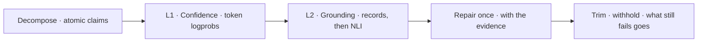
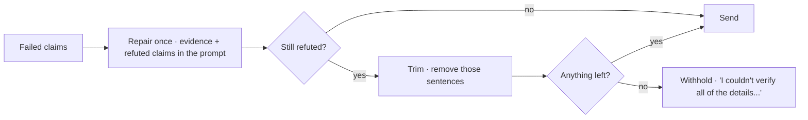




A schema can guarantee that a reply has the right **shape**. It cannot guarantee that what the reply says is **true**. A perfectly formed sentence such as "_your refund of $118.84 has been issued_" is a serious failure if the refund is actually waiting for review.

These notes define a hallucination precisely for an agent (a claim not supported by what the turn actually observed), explain why it is costly, and develop a two-level check that runs after the model writes and before the user reads:
cheap **token-confidence** signals from log-probabilities, and **grounding** of each atomic claim against evidence, using deterministic record checks and natural-language inference.

By the end of these notes you should be able to:
- distinguish intrinsic (contradicted) from extrinsic (unsupported) hallucinations;
- explain how NLI decides entailment, and why embedding similarity cannot;
- use log-probabilities as a cheap first signal while knowing their limits;
- describe a repair, trim and withhold policy for replies that fail.



In [Guardrails](), Pydantic checked the **shape** of a reply: a non-empty string, the right fields, the right types.
But a perfectly shaped reply can still say something false: "_Your refund of $118.84 has been issued_", when the refund is actually **queued for review**.

These notes are about the second check: **is what the reply says true, given what the agent actually observed?**
In the [CSA](), every drafted reply gets a hallucination-check card in the trace with two levels:
**token confidence** (how sure the model was of each sentence) and **NLI entailment** (each claim, the evidence it was checked against, and the verdict).



📘 A working definition from the summarisation literature (Maynez et al., 2020; Ji et al.'s survey, 2023):
a hallucination is output that is **not supported by the source**. It comes in two kinds:

| | **Intrinsic** (contradicted) | **Extrinsic** (unsupported) |
|---|---|---|
| Meaning | The output **contradicts** the source | The output says something the source **doesn't contain** |
| Example | Record says "_queued for review_"; reply says "_issued_" | Reply promises "_within 24 hours_"; nothing in the evidence says so |
| Can it be true? | No | Possibly, but you can't tell from here |

For an **agent**, the "source" is everything the turn actually **observed**: tool results, retrieved passages, policy.
A hallucination check asks, for each thing the reply asserts: **is it entailed by what the agent observed?**



Three real-world shapes of the same failure:

- ✈️ **Airline**: in _Moffatt v. Air Canada_ (2024), the airline's website chatbot told a customer he could claim a bereavement fare refund **after** travel. The policy said otherwise.
  The tribunal held the airline responsible for what its chatbot said.
- ⚖️ **Law**: in _Mata v. Avianca_ (2023), lawyers filed a brief citing cases ChatGPT had **invented**, complete with invented quotes. The court sanctioned them.
- 🎧 **Support agents**: a refund was queued for review, but the draft says "_your refund has been issued_". A customer told money is coming plans around it.

The common thread: the reply was **fluent, specific and confident**. Nothing in its tone said "_guess_".
That's why a hallucination can't be caught by reading the reply; it has to be checked against the evidence.

**Nothing in a hallucination's tone says "guess".**




1. **Decompose** the reply into **atomic claims**: sentences, then split again at conjunctions and semicolons.
2. **Level 1, token confidence**: how sure was the model of the words it wrote? Free with the completion.
3. **Level 2, grounding**: is each claim entailed by the evidence? Deterministic checks for records first, then NLI.
4. **Repair**: one bounded rewrite, with the evidence in front of the model.
5. **Trim or withhold**: whatever is still refuted is removed; if nothing survives, a withheld reply goes instead.

**Check each claim, not the reply: one false sentence hides in five true ones.**



**Natural Language Inference** (NLI; SNLI, Bowman et al., 2015; MultiNLI, Williams et al., 2018): given a **premise** and a **hypothesis**, does the premise **entail** the hypothesis, **contradict** it, or neither (**neutral**)?

| Premise: "_The forecast for Pune on 2 October is light drizzle with a high of 32.5 °C._" | Verdict |
|---|---|
| "_It will drizzle in Pune on 2 October._" | ✅ Entailment |
| "_It will be dry in Pune on 2 October._" | ❌ Contradiction |
| "_Pune's railway station has six platforms._" | ➖ Neutral: not about this |

For a hallucination check, **premise = evidence** and **hypothesis = the claim**: entailed → **supported**; contradicted → **refuted**; neutral → **unverified**.
Three verdicts, not two: "_I can't confirm this_" is different from "_this is false_".

**Embeddings find, NLI decides.** Two models, two jobs:



- **Embeddings retrieve**: for each claim, find the top 3 most similar evidence sentences. But **similarity is not truth**: "_the refund was issued_" and "_the refund was not issued_" are near-identical vectors.
- **NLI decides**: a [cross-encoder]() (a local DeBERTa-v3 NLI model, a [BERT]()-family encoder) reads claim and evidence **together** and sees the negation. Entailment ≥ 0.6 → supported.

**Embeddings never decide whether a claim is true. NLI does.**



Before NLI: what does the reply actually claim, and **what kind of claim** is it?

**Decompose finely.** "_The refund has not been initiated; the status shows none_" was once checked as a single claim against evidence matching only half of it, so a half-verbatim sentence scored as entirely unsupported.
Splitting at semicolons and conjunctions makes each piece checkable on its own.

**Classify**: the class decides what may ground it.

| Class | Example | Grounded by |
|---|---|---|
| 🧾 **record** | "_$18.70 has been refunded._" | **Tool results only**: only a record can show what happened to this case |
| 📜 **rule** | "_You'll hear back soon._" | The **policy** that makes the promise |
| 💬 **conversational** | "_Thanks for reaching out._" | Nothing: it asserts nothing, so it isn't checked |

Checking conversational sentences is how a courteous reply once got flagged as a hallucination.

**The class decides what may ground a claim.**



NLI is the workhorse, but it has known blind spots, each with a mitigation:

| Limit | Symptom | Mitigation |
|---|---|---|
| **Facts across lines** | A web page states one fact over several short lines; a sentence joining them is entailed by no single premise → **neutral** | Passage windows (support-only), and a **confirm-only** second model |
| **Conditional rules** | "_before it ships..._" vs "_once it ships..._" reads as a contradiction | Rule claims checked **only against policy** |
| **Numbers and states** | $118.84 ≈ $118.48 to NLI; state machines are opaque to it | **Direct check**: read the field |
| **Long premises** | Truncated at 512 tokens | Retrieve the best sentences first |

The second-opinion model is instructive: on one test turn it confirmed 5/5 true claims where NLI confirmed 2/5, but it also accepted a wrong relation.
So it is allowed to **confirm**, never to **refute**.

**A second model may confirm; only NLI and the record may refute.**



A **record** claim is settled **without a model** whenever a field can settle it. Each finding gets a reason code:

| Reason code | Means |
|---|---|
| `CLAIM_WITHOUT_TOOL_EVIDENCE` | A claim about this case with no tool result behind it |
| `IDENTIFIER_MISMATCH` | An order id the record doesn't hold |
| `AMOUNT_MISMATCH` | An amount not in the record |
| `RECORD_STATE_MISMATCH` | A state the refund state machine rules out ("_issued_" vs "_queued for review_") |
| `NOT_EXECUTED` | The claim reports the effect of a call that was **refused** |

A refused call (e.g. [the Gatekeeper said ESCALATE or DENY]()) is written into the evidence as **NOT EXECUTED**: it grounds "_that was refused_", never "_it happened_".
Only what the direct check can't place goes on to NLI.

**A refused call grounds "it was refused", never "it happened".**



For every token it emits, a model can return the **log-probability** it assigned to that token (the output of the final [softmax]() over the vocabulary). A model that is guessing spreads probability over several candidates, so the token it picks carries a **low** probability.



The words are sure; the digits of an amount the model never saw are a guess. Per sentence we compute:

\[\bar{p} = \frac{1}{|C|}\sum_{t \in C} e^{\log p(t)} \qquad \text{low share} = \frac{|\{t \in C : p(t) < 0.2\}|}{|C|}\]

where \(C\) is the sentence's **content** tokens (grammar words are left out: a low-probability "_the_" means another phrasing, not a guess). Asking for logprobs costs nothing extra.

**Two deterministic cuts.** Confidence is not truth, so every claim still goes to grounding. But logprobs alone may remove a sentence in exactly two cases:
- **Degenerate sentence**: content tokens average below 0.5 → cut, whatever grounding says.
- **Shaky specific**: an id, amount, date or number written with probability below 0.2 → its claim is cut **unless the record confirms it**. That is the made-up-number signature.

Otherwise a sentence is merely **marked** LOW (mean under 0.6, or more than 25% of tokens under 0.2): information, not a removal.

**What logprobs can't tell you**:

| Limit | So |
|---|---|
| **Confidently wrong**: a learned false fact is stated with high probability | Logprobs measure **doubt, not error**: level 2 runs on every claim |
| **Over-confidence**: instruction-tuned models aren't calibrated (Kadavath et al., 2022; GPT-4 report) | Thresholds are per model, in config |
| **Not always returned** by every provider | The trace says so; grounding runs anyway |
| **Reasoning tokens** are generated too | Only the tokens that wrote the sentence are scored |

**Confidence is not truth. It is a reason to look harder.**



Each of these is legitimate; each has a cost that doesn't fit an agent answering a customer in real time on hosted models:

| Method | Idea | Why not here |
|---|---|---|
| **Self-consistency / SelfCheckGPT** (Manakul et al., 2023) | Sample N answers; claims that don't recur are suspect | N× cost and latency (built, and left off) |
| **Semantic entropy** (Farquhar et al., _Nature_ 2024) | Entropy over meaning clusters of N samples | N× cost + clustering |
| **Chain-of-Verification** (Dhuliawala et al., 2023) | The model questions and revises its own draft | More calls; the checker shares the author's blind spots |
| **LLM judge / FActScore** (Min et al., 2023) | A model verifies each atomic claim | Cost per claim; [judges hallucinate too]() |
| **Internal-state probes** (Azaria & Mitchell, 2023) | A classifier on hidden activations | Needs model internals a hosted API doesn't expose |

**Don't ask the author to grade its own work, and don't pay N× on every reply.**



The check is organised in **levels**, and every agent's trace card reads the same way:
- **Level 1** is the platform's, identical for every agent: **token confidence**.
- **Level 2** is whatever grounds **this** agent's claims: NLI against evidence for a reply (CSA, RA answers), or a figure found in a query result for an answer computed from one.

**What happens to a reply that fails**:

1. **Repair once**: one bounded rewrite, with the evidence and the refuted claims listed. If the draft has **no** evidence behind its business claims, the deterministic gate runs first: asking a model to rewrite with nothing to rewrite from produces a second hallucination.
2. **Trim**: what's still refuted is removed, sentence by sentence.
3. **Withhold**: if nothing survives, a configured withheld reply goes instead.

Whether a person then reviews it is the **agent's** decision, not the guardrail's.

**Pydantic constrains the shape; the hallucination check constrains the claims.**



A reply says "Your refund of $118.84 has been issued." The tool result says `status: queued_for_review, amount: 118.84`. Which checks catch it, and what does the customer receive?



It's a **record** claim, so the **direct check** runs first: the amount matches, but "_issued_" is a **RECORD_STATE_MISMATCH** (the state machine doesn't allow _issued_ from _queued for review_). NLI would also mark it **contradicted**.
The guardrail **repairs once** with the evidence in front of the model ("_Your refund of $118.84 is queued for review_"); if the repair still fails, the sentence is **trimmed**, and if nothing survives, the **withheld** reply is sent.



- 🔍 **Hallucination** = not supported by what the turn observed: contradicted or unsupported.
- ⚖️ **NLI decides; embeddings only retrieve.** Records are read, not inferred.
- 🎲 **Logprobs are level 1**: cheap doubt, two deterministic cuts, never the whole check.
- ✂️ **Repair once, trim, withhold.** Never ask the author to grade itself.

💡 _Check each claim against what the agent saw, not how sure it sounded._



Concepts used in these notes are developed in the other courses on this site:

- Deep Learning: [Softmax]()
- NLP: [BERT]()
- Machine Learning: [Log Loss]()



- Maynez et al., [_On Faithfulness and Factuality in Abstractive Summarization_](https://arxiv.org/abs/2005.00661) ACL (2020).
- Ji et al., [_Survey of Hallucination in Natural Language Generation_](https://arxiv.org/abs/2202.03629) ACM Computing Surveys (2023).
- [_Moffatt v. Air Canada, 2024 BCCRT 149_](https://en.wikipedia.org/wiki/Moffatt_v._Air_Canada) a company held responsible for its chatbot.
- [_Mata v. Avianca, Inc. (S.D.N.Y. 2023)_](https://en.wikipedia.org/wiki/Mata_v._Avianca,_Inc.) sanctions for invented case citations.
- Bowman et al., [_A Large Annotated Corpus for Learning Natural Language Inference (SNLI)_](https://arxiv.org/abs/1508.05326) EMNLP (2015).
- Williams et al., [_A Broad-Coverage Challenge Corpus for Sentence Understanding through Inference (MultiNLI)_](https://arxiv.org/abs/1704.05426) NAACL (2018).
- Kadavath et al., [_Language Models (Mostly) Know What They Know_](https://arxiv.org/abs/2207.05221) (2022): calibration.
- Manakul et al., [_SelfCheckGPT_](https://arxiv.org/abs/2303.08896) (2023).
- Farquhar et al., [_Detecting Hallucinations in Large Language Models Using Semantic Entropy_](https://doi.org/10.1038/s41586-024-07421-0) Nature (2024).
- Dhuliawala et al., [_Chain-of-Verification Reduces Hallucination in Large Language Models_](https://arxiv.org/abs/2309.11495) (2023).
- Min et al., [_FActScore_](https://arxiv.org/abs/2305.14251) (2023).
- Azaria & Mitchell, [_The Internal State of an LLM Knows When It's Lying_](https://arxiv.org/abs/2304.13734) (2023).


<!-- nav-panel:start -->

<a href="">Previous: Memory Management</a>
<a href="">Next: LLM as a Judge</a>

<!-- nav-panel:end -->
