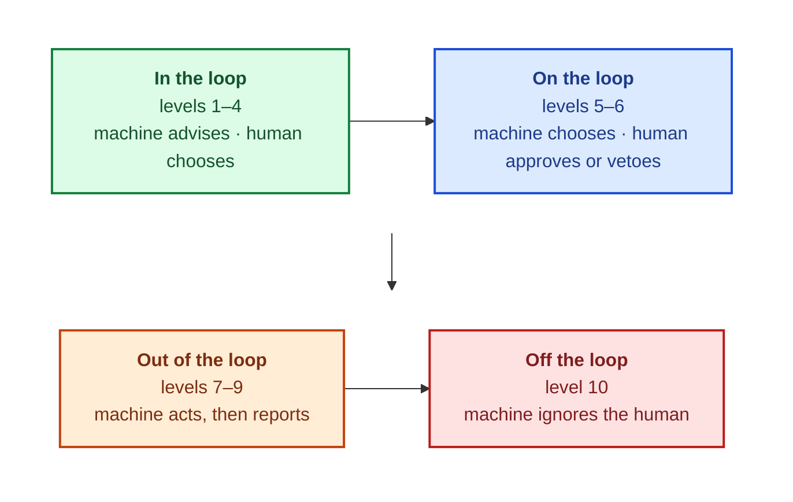




"Is your agent autonomous?" is one of the most common questions asked about AI agents, and one of the least useful. Real systems are autonomous for some decisions, supervised for others, and fully manual for a few, often within a single conversation.
These notes replace the yes/no question with a vocabulary borrowed from **human factors engineering**, a field that has studied the division of work between people and machines since the 1950s, in aviation, process control and undersea robotics.

By the end of these notes you should be able to:
- describe Sheridan's ten levels of automation and the four places a human can sit relative to an automated decision;
- explain why putting "a human in the loop" can fail, and what makes human oversight meaningful;
- decide, for each step of a system, whether code, a model or a person should do the work, using three questions;
- record and justify an autonomy decision so that it can be reviewed and changed deliberately.



A single customer sends our [support agent]() three requests in one session.

The first is "_Where's my order?_". An intent classifier routes it to a database read; **no model is called at all**, and the answer comes straight from the orders table.
The second is a refund for $30.95. The model proposes it, the [Gatekeeper]() allows it because it is under the limit, it executes, and the customer is told. No person is involved, although every step is recorded.
The third is a refund for $118.84. The model proposes it in exactly the same way, but the Gatekeeper escalates it. The run pauses, saves its state, and waits for a person to decide.

So is this agent autonomous? For the first request the question doesn't even apply (no model was involved); for the second, yes; for the third, no. The same agent sits at three different points on a spectrum within minutes.
The useful question is not "_is the agent autonomous?_" but "**which decision runs at which level, and why?**"




Most discussions of agents treat autonomy as a **switch**: either a human approves everything, or the agent runs free. Every serious automation field abandoned that framing long ago, because it hides exactly the decisions that matter.
A vendor describing a product as "fully autonomous" has told you nothing about its risk.

The alternative is to treat autonomy as a **dial**, set separately for each decision. The vocabulary for the dial comes from **Thomas Sheridan** and **William Verplank** at MIT's Man-Machine Systems Laboratory,
whose 1978 report for the US Office of Naval Research studied how much a human operator should delegate to a remotely operated undersea vehicle.

**Autonomy is not a property of an agent. It is a property of each decision.**



Sheridan's scale describes, for a single decision, how the work is divided between the computer and the human. The form most people cite is the table in Parasuraman, Sheridan and Wickens (2000). Read each line as continuing "_The computer..._":

| Level | The computer... |
|---|---|
| **10** | decides everything and acts autonomously, ignoring the human |
| **9** | acts, and informs the human only if it decides to |
| **8** | acts, and informs the human only if asked |
| **7** | executes automatically, then necessarily informs the human |
| **6** | allows the human a restricted time to veto before it executes |
| **5** | executes its suggestion if the human approves |
| **4** | suggests one alternative |
| **3** | narrows the selection down to a few |
| **2** | offers a complete set of decision or action alternatives |
| **1** | offers no assistance: the human makes every decision and takes every action |

The interesting boundaries are not the extremes. Between **4 and 5**, the question changes from "_who chooses?_" to "_who approves?_": at level 4 the human still chooses; at level 5 the computer chooses and the human approves.
Between **6 and 7**, the question is whether a human sees the action **before** it happens or only **after**. Most real risk decisions live at those two boundaries.


Consider an email assistant doing the same job, handling your inbox, at every level.
At level 1 you write every email yourself. At level 2 it shows your saved reply templates. At level 3 it offers three short replies and you pick one, which is exactly Gmail's **Smart Reply** (Kannan et al., 2016).
At level 4 it drafts one reply for you to edit. At level 5 it sends its draft when you click _Approve_. At level 6 it sends in ten seconds unless you press _Undo_, which is **Undo Send**.
At level 7 it auto-replies and then shows you what it sent. At level 8 it files mail to spam, and you only see it if you go and look. At level 9 it sends you a digest of only what it thinks matters. At level 10 it silently deletes mail it dislikes.


Ask yourself at which rung you would stop being comfortable. Most people answer somewhere between 6 and 7, and the reason is never "_the model isn't smart enough_". It is **blast radius**: an email you can't take back.



The ten levels group naturally into four bands, according to what the human actually does. Industry language describes the first three as being _in_, _on_ and _out of_ the loop:

- **In the loop**: Smart Reply; a maps app offering three routes and letting you choose.
- **On the loop**: "_Approve to send_"; Undo Send's veto window.
- **Out of the loop**: an auto-reply; the spam folder; a bank approving your card payment and showing it on your statement later.
- **Off the loop**: silent auto-delete; in agent terms, our support agent with the [Gatekeeper switched off]().

Real systems sit in several bands at once, and that is perfectly fine. What is not fine is **not knowing which decision sits in which band**.



It is tempting to conclude that the safe choice is always to keep a human in the loop. The human-factors literature has a well-known counterweight: Lisanne Bainbridge's 1983 paper _Ironies of Automation_, one of the most cited papers in the field.

Bainbridge's central irony is that automating a system leaves the human with the tasks the designers _couldn't_ automate, which are usually the hardest, while removing the everyday practice that kept the human good at them. Three failure modes follow:

- **Vigilance decays.** People are poor monitors of things that are almost always right. In AI systems this appears as **automation bias**: a reviewer who approves whatever the queue shows.
- **Skill decays.** A reviewer who only sees rare edge cases loses the judgement those cases require.
- **Handovers come at the worst moment.** The automation hands over exactly the case it cannot handle, with the least context, at the hardest time.

The design response is to make human oversight **meaningful** rather than ubiquitous. In the support agent, only above-limit refunds reach the review queue, so the queue stays small and each item matters.
Each escalation carries its **reason and amount**, so the reviewer receives evidence, not just a yes/no button. And the system **measures how often reviewers override** the agent: an override rate of zero does not indicate a safe system; it indicates a rubber stamp.

**A human in the loop is a control only if the human can really say no.**



Choosing a level is one decision; choosing **who does the work** is another. Human factors has a method for this too. In 1951, Paul Fitts edited a report for the US National Research Council on air-navigation and traffic-control systems.
It contained what became known as the **Fitts list**: what humans are better at, and what machines are better at. The method it introduced, **allocating each function to whoever does it best**, is still how safety-critical systems are designed.

With language models, the list needs a third column:

| Code is better at | Models are better at | People are better at |
|---|---|---|
| Enumerable rules, exact repetition, proof | Open-ended language, ambiguity, paraphrase | Accountability, novel judgement, saying no |
| Same input, same output | Situations where rules break | Being answerable: nobody can sue a model |

The key word is **function**. "_Should this be an agent?_" is the wrong grain of question; "_who should own this step?_" is the right one.



To allocate a step, ask three questions of **each step**, never of the system as a whole.

1. **Cardinality.** How many distinct situations must this step handle? If you can enumerate them, code wins: it is cheaper, faster and provable. If you cannot (free-form customer language, the open web), a model earns its place.
2. **Blast radius.** What is the worst plausible cost of a wrong call, and can it be undone? A clumsy sentence is cheap and fixable. Money leaving, data leaking or trust lost are not.
3. **Certifiability.** Must the behaviour be **proven**, or is **measuring** it enough? An auditor or regulator asks for proof; a product manager may accept a pass rate. This is the question teams most often forget, and it is the one that decides what _must_ be code.

The third question comes from avionics. Under **DO-178C**, the standard for airborne software, the most critical software (Level A) must have every decision path demonstrated.
A rule can be proven: the same input always gives the same output. A model cannot: the same input gives a distribution of outputs, which can be measured with eval sets and confidence intervals but never proven.

Applying the three questions yields a decision rule:

| Example | Cardinality · blast radius · certifiability | Who does the work |
|---|---|---|
| Sales tax | Low · low · measure | **Code**: it is cheaper and faster |
| Interest calculation, autopilot logic | Low · high · prove | **Code**, certified |
| Product recommendations | High · low · measure | **A model**, evaluated |
| Claim payouts, loans, refunds | High · high · prove the limit | **Split**: the model proposes, code authorises, a person decides above a threshold |

The last row is the important one. When a decision is both open-ended and high-stakes, no single owner works, so we split it: the open-ended part (estimating the amount) goes to the model and is measured; the limit check goes to code and is proven.
That split is exactly the [Gatekeeper pattern]() from the first notes.

**Certify the rule, measure the model: the model proposes, the rule authorises.**

[Read more about Performance Metrics]()



Consider a car-insurance claims pipeline, outside our codebase but typical of how mature insurers divide the work. For each step we answer two separate questions: **who does the work** (code, a model or a person, from the three questions) and **what the human does** (the Sheridan level).

| Step | Card. · Blast · Certify | Who does the work | Level: the human's role |
|---|---|---|---|
| Check the policy is active | Low · high · prove | Code: a lookup | **8**: nothing per claim; logged for audit |
| Read the claim documents | High · medium · measure | A model reads photos and PDFs | **7**: the adjuster sees it on the file |
| Flag likely fraud | Medium · high · measure | A model scores the risk | **4**: an investigator decides |
| Estimate the payout, under the limit | High · high · measure | A model proposes; code checks the limit | **7**: paid, then the customer is told |
| Estimate the payout, over the limit | High · high · measure | A model proposes; code checks the limit | **5**: an adjuster approves |
| Write the customer letter | Medium · medium · measure | A model drafts; code checks amounts and dates | **7**: a copy goes on file |
| Pay the claim | Low · high · prove | Code, idempotent | **7**: paid, then the customer is told |

Two lessons stand out. First, the level describes the **human's role**, not the technology: deterministic code that pays a claim and then notifies is level 7, exactly like a model doing the same.
Second, the same step, estimating the payout, runs at **two different levels depending on the amount**. That is the same move as the support agent's $50 refund limit.

[Read more about Binary Classification]()



A level that exists only in someone's head will drift. A practical artifact is an **Autonomy Decision Record**, written in the spirit of an Architecture Decision Record: one record per decision that has a level, kept next to the code.

| Field | Worked example: claim payout |
|---|---|
| **Decision** | Pay a car-damage claim |
| **Cardinality** | High to estimate (any photo, any damage); low to pay |
| **Blast radius** | High: money out, and fraud exposure |
| **Certifiability** | The payment rule is provable; the estimate is only measurable |
| **Level** | 7 under the threshold; 5 above it |
| **Human** | A claims adjuster, through a review queue |
| **Evidence** | Estimate evals against adjusters' decisions; tests on the payment rule |
| **Moves the dial** | The risk committee changes the threshold |

The last three rows do most of the work. "_Human_" must name a role with a queue, not just "_a human_". "_Evidence_" says what keeps the level honest ([evals]() for the measured part, tests for the proven part).
"_Moves the dial_" says who may change the level. If you cannot fill in those rows, you do not have a level; you have a default.



The course uses two reference agents with very different profiles, and the same method gives them very different shapes.

The **customer support agent (CSA)** moves money, so its blast radius is high and its choices are narrow. Its human sits **before the act**. Status questions are answered from the database with no model call.
Refunds up to $50 are proposed by the model and allowed by code (level 7); refunds above $50 wait for a person (level 5). Every step that moves money is code; the model only ever proposes.

The **research agent (RA)** reads the web, so its blast radius is bounded but its choices are vast. Its human sits **before the run**: you approve a contract (the brief and the acceptance rubric), which is then frozen (level 5).
After that it plans, searches and writes on its own, within budgets (level 7). Whether the result is COMPLETE or PARTIAL is decided by code, not by the model.

**Approve the action when acts are costly. Approve the contract when the search is vast.**

Finally, a level is only real if it lives in **configuration**. Three kinds of setting move the dial:
- a **threshold** (auto-pay under $2,000) moves the line between levels 7 and 5;
- a **window** (undo within 10 seconds) is what makes level 6 level 6;
- a **fence** (step caps, budgets, confidence cut-offs) bounds how far a level-7 run may go ([Loop Control]()).

Each of these is an operator decision, audited, and never something the model can reach. If the level isn't in configuration, it isn't a decision; it's an accident.



A refund agent sends every refund, of any size, to a human for approval. Is that the safest design?



Usually **not**. A queue full of trivial approvals invites the **ironies of automation**: vigilance decays and reviewers rubber-stamp, so the human check stops being a check.
A better design allocates per decision: small, reversible refunds at **level 7** (the model proposes, code allows, everything audited) and large ones at **level 5**, with the reason and amount attached, while tracking the reviewers' override rate.



- **Autonomy is a dial**, set per decision. Sheridan's ten levels give the vocabulary; the boundaries at 4→5 (who chooses) and 6→7 (does a human see it first) carry most of the risk.
- **Code or model is who works; the level is what the human does.** Allocate each function using cardinality, blast radius and certifiability.
- **Split high-stakes, open-ended decisions**: the model proposes, code authorises, a person decides above a threshold.
- **Human oversight must be meaningful** to be a control, and every level should be written down, evidenced, and held in configuration.

_Don't ask whether your agent is autonomous. Ask which decisions are, at what level, and who moves the dial._



- Sheridan & Verplank, [_Human and Computer Control of Undersea Teleoperators_](https://apps.dtic.mil/sti/citations/ADA057655), MIT Man-Machine Systems Laboratory (1978): the original ten-level scale.
- Parasuraman, Sheridan & Wickens, [_A Model for Types and Levels of Human Interaction with Automation_](https://doi.org/10.1109/3468.844354), IEEE Trans. SMC-A (2000): the table most people cite.
- Bainbridge, [_Ironies of Automation_](https://doi.org/10.1016/0005-1098%2883%2990046-8), Automatica (1983): why human oversight can fail.
- Fitts (ed.), [_Human Engineering for an Effective Air-Navigation and Traffic-Control System_](https://skybrary.aero/bookshelf/human-engineering-effective-air-navigation-and-traffic-control-system), National Research Council (1951): the origin of function allocation.
- Kannan et al., [_Smart Reply: Automated Response Suggestion for Email_](https://arxiv.org/abs/1606.04870), KDD (2016): a real level-3 system.
- RTCA, [_DO-178C: Software Considerations in Airborne Systems and Equipment Certification_](https://www.rtca.org/do-178/) (2011); see also the [overview on Wikipedia](https://en.wikipedia.org/wiki/DO-178C).


<!-- nav-panel:start -->

<a href="">Previous: What Is an AI Agent, Really?</a>
<a href="">Next: Workflow Design Patterns</a>

<!-- nav-panel:end -->
