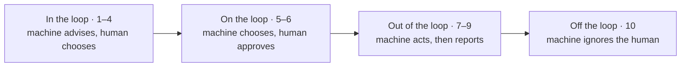




Three requests from the **same customer**, in the **same session**, to our [customer support agent]():

| Request | What happened | Human involved? |
|---|---|---|
| "Where's my order?" | Routed by a classifier to a database read. **No model call at all.** | No |
| Refund · $30.95 | Model proposes, **Gatekeeper allows**, it runs and tells her. | No (but audited) |
| Refund · $118.84 | Model proposes, **Gatekeeper escalates**, the run pauses. | **Yes, a person must decide** |

Is this agent autonomous? Yes, no and partly, in the same session.

👉 "_Is it autonomous?_" is the wrong question. "**Which decision, at what level?**" is the right one.



📘 Most conversations treat autonomy as a **switch**: either a human approves everything, or the agent runs free.
Every serious automation field abandoned that framing decades ago.

| | |
|---|---|
| ❌ **The wrong question** | "_Is your agent autonomous?_" Yes/no hides every decision that matters. |
| ✅ **The right question** | "_Which decision runs at which level, and why?_" A level per decision, each one justified. |

💡 **Autonomy is not a property of an agent. It is a property of each decision.**

_Borrowed from human factors engineering_: Sheridan & Verplank, MIT Man-Machine Systems Laboratory, 1978.



Thomas Sheridan's scale, from work on remotely operated undersea vehicles. Each line continues "_The computer..._":

| Level | The computer... | Band |
|---|---|---|
| **10** | Decides everything and acts autonomously, ignoring the human | Off the loop |
| **9** | Acts, and informs the human only if it decides to | Out of the loop |
| **8** | Acts, and informs the human only if asked | Out of the loop |
| **7** | Executes automatically, then necessarily informs the human | Out of the loop |
| **6** | Allows the human a restricted time to veto before it executes | On the loop |
| **5** | Executes its suggestion if the human approves | On the loop |
| **4** | Suggests one alternative | In the loop |
| **3** | Narrows the selection down to a few | In the loop |
| **2** | Offers a complete set of decision / action alternatives | In the loop |
| **1** | Offers no assistance: the human makes every decision and action | In the loop |

💡 The interesting lines aren't 1 vs 10. They are **4 → 5** (_who chooses_) and **6 → 7** (_whether a human sees it before it happens_).

**One inbox, ten levels**: an email assistant at every rung.

| Level | Email assistant |
|---|---|
| 1 | Nothing: you write and send every email yourself |
| 2 | Shows every reply template you have saved |
| 3 | Offers three short replies; you pick one (Gmail **Smart Reply**) |
| 4 | Drafts one reply; you edit and send it |
| 5 | Drafts a reply and sends it when you click Approve |
| 6 | Sends in 10 seconds unless you hit Undo (**Undo Send**) |
| 7 | Auto-replies, then shows you what it sent |
| 8 | Files mail to spam; you see it only if you look |
| 9 | Sends you a digest of only what it thinks matters |
| 10 | Deletes mail it dislikes, without a trace |

Where would you stop being comfortable? Most people say between 6 and 7, and the reason is never "_the model isn't smart enough_". It's **blast radius**: an email you can't take back.



Ten levels, four places for the human:

| Band | Levels | Example |
|---|---|---|
| 🧑‍💻 **In the loop** | 1–4 | Smart Reply · three route options in a maps app |
| 👀 **On the loop** | 5–6 | Approve to send · Undo Send |
| 📬 **Out of the loop** | 7–9 | Auto-reply · spam folder · card payment shown on your statement |
| 🚫 **Off the loop** | 10 | Silent auto-delete · an agent with the [Gatekeeper off]() |

👉 Real systems sit in several bands at once. **Not knowing which decision is in which band is the risk.**



Putting a human "in the loop" has failure modes of its own (Lisanne Bainbridge, _Ironies of Automation_, 1983):

- 😴 **Vigilance decays**: people are poor monitors of things that are almost always right → approving whatever the queue shows (automation bias).
- 📉 **Skill decays**: the reviewer loses the practice the hard cases need → judgement fades with disuse.
- 🤝 **Bad handovers**: automation hands over exactly the case it can't handle → hardest case, least context.

✅ What we do about it in the CSA design:
- Only **above-limit** refunds reach the queue, so it stays small and meaningful.
- The escalation carries its **reason and amount**: the reviewer gets evidence, not a yes/no button.
- We measure **how often reviewers override**. An override rate of zero isn't a safe system; it's a rubber stamp.

💡 **A human in the loop is a control only if the human can really say no.**



How do you choose deterministic code vs. a model vs. a person for each step?
Paul Fitts' 1951 report on air-traffic control introduced the **Fitts list**: what humans are better at, and what machines are better at.
The 2026 version needs **three columns**:

| 🧮 **Code** is better at | 🧠 **Models** are better at | 🧑 **People** are better at |
|---|---|---|
| Enumerable rules, exact repetition, proof | Open-ended language, ambiguity, paraphrase | Accountability, novel judgement, saying no |
| Same input, same output | Where rules break | Nobody can sue a model |

💡 **Allocate each function, not each agent.** "_Should this be an agent?_" is the wrong grain. "_Who should own this node?_" is the right one.



The worksheet. Ask all three of **every node**, never of the agent as a whole:

| Question | Asks | Low → | High → |
|---|---|---|---|
| 🔢 **Cardinality** | How many distinct situations must it handle? | Enumerable | Open-ended |
| 💥 **Blast radius** | Worst plausible cost of a wrong call, and can it be undone? | Cheap, reversible | Money, data, trust |
| 📜 **Certifiability** | Must it be proven, or is measuring enough? | Proof needed → **code** | Pass rate enough → **model** |

**The decision rule.** Certifiability comes from avionics: under **DO-178C** Level A, every decision path must be proven.
A rule can be proven (same input, same output); a model can only be **measured** (eval sets, pass rates, confidence intervals).

| Example | Cardinality · Blast · Certify | Decision |
|---|---|---|
| Sales tax | Low · Low · Measure | **Code**: cheaper, faster |
| Interest calculation, autopilot logic | Low · High · Prove | **Code**, certified |
| Product recommendations | High · Low · Measure | **Model**, evaluated |
| Claim payouts, loans, refunds | High · High · Prove the limit | **Split**: model proposes, code authorises, human above threshold |

💡 **Certify the rule, measure the model: the model proposes, the rule authorises.**

[Read more about measuring models with Evals]()



Every step answers two separate questions: **who does the work** (code, model or person), and **what the human does** (the Sheridan level).

| Step | Card. · Blast · Certify | Who does the work | Level: the human's role |
|---|---|---|---|
| Check policy is active | Low · High · Prove | Code: a lookup | **8** · nothing; logged |
| Read claim documents | High · Med · Measure | Model reads photos, PDFs | **7** · sees it on the file |
| Flag likely fraud | Med · High · Measure | Model scores the risk | **4** · investigator decides |
| Payout, under limit | High · High · Measure | Model proposes, code checks | **7** · paid, then told |
| Payout, over limit | High · High · Measure | Model proposes, code checks | **5** · adjuster approves |
| Write customer letter | | Model drafts, code checks | **7** · copy on file |
| Pay the claim | Low · High · Prove | Code, idempotent | **7** · paid, then told |

👉 **Code or model is _who works_. The level is _what the human does_.**
Deterministic code that pays automatically and then notifies is level 7, exactly like a model doing the same.

💡 The same step (estimate the payout) runs at **two levels depending on the amount**: the same move as the CSA's $50 refund limit.



An artifact to take to work: one record per decision that has a level, kept next to the code (in the spirit of an Architecture Decision Record).

| Field | Worked example · claim payout |
|---|---|
| **Decision** | Pay a car-damage claim |
| **Cardinality** | High to estimate (any photo, any damage); low to pay |
| **Blast radius** | High: money out, and fraud exposure |
| **Certifiability** | Payment rule provable; the estimate only measurable |
| **Level** | 7 under the threshold · 5 above |
| **Human** | A claims adjuster, through a review queue |
| **Evidence** | Estimate evals vs adjusters · payment-rule tests |
| **Moves the dial** | The risk committee changes the threshold |

👉 **No evidence, no level.** If you can't fill in "_evidence_" or "_moves the dial_", you don't have a level; you have a default.



The same three questions, applied to the course's two reference agents:

| | **CSA** (customer support) · human **before the act** | **RA** (research agent) · human **before the run** |
|---|---|---|
| Nature | Moves money: high blast, narrow choices | Reads the web: bounded blast, vast choices |
| Decisions | Status reads: code, no model · Refund ≤ $50: model proposes, code allows → **7** · Refund > $50: waits for a person → **5** | You approve the contract (brief + rubric) → **5** · Plans, searches, writes alone, within budgets → **7** · COMPLETE / PARTIAL verdict decided by code |

💡 **Approve the action when acts are costly. Approve the contract when the search is vast.**

**The dial is configuration**: if the level isn't in config, it isn't a decision; it's an accident.

- 🎚️ **The threshold** (auto-pay under $2,000): moves the line between level 7 and level 5.
- ⏱️ **The window** (undo within 10 seconds): turns level 7 into level 6.
- 🚧 **The fence** (step caps, budgets, confidence cut-offs): how far a level-7 run may go.

[Read more about loop budgets and approval gates]()



A refund agent sends every refund, of any size, to a human for approval. Is that the safest design?



Usually **not**. A queue full of trivial approvals triggers the **ironies of automation**: vigilance decays and reviewers rubber-stamp.

Allocate per decision instead: small, reversible refunds at **level 7** (model proposes, code allows, audited), large ones at **level 5** with the reason and amount attached, and track the reviewers' override rate.



- 🎚️ **Autonomy is a dial.** Sheridan's ten levels, set per decision.
- 🧑‍🔧 **Code or model is who works. The level is what the human does.**
- ❓ **Three questions per node.** Cardinality, blast radius, certifiability.
- ✂️ **Split high-stakes decisions.** Model proposes, code authorises, human above the limit.

💡 _Don't ask whether your agent is autonomous. Ask which decisions are, at what level, and who moves the dial._


_Reference_:
- Sheridan & Verplank, Human and Computer Control of Undersea Teleoperators, MIT Man-Machine Systems Laboratory, 1978
- Parasuraman, Sheridan & Wickens, A Model for Types and Levels of Human Interaction with Automation, IEEE Trans. SMC-A 30(3), 2000, https://doi.org/10.1109/3468.844354
- Bainbridge, Ironies of Automation, Automatica 19(6), 1983, https://doi.org/10.1016/0005-1098(83)90046-8
- Fitts (ed.), Human Engineering for an Effective Air-Navigation and Traffic-Control System, National Research Council, 1951
- Kannan et al., Smart Reply: Automated Response Suggestion for Email, KDD 2016, https://arxiv.org/abs/1606.04870
- RTCA DO-178C / EUROCAE ED-12C, Software Considerations in Airborne Systems and Equipment Certification, 2011

<!-- nav-panel:start -->

<a href="">Previous: What Is an AI Agent, Really?</a>
<a href="">Next: Workflow Design Patterns</a>

<!-- nav-panel:end -->
