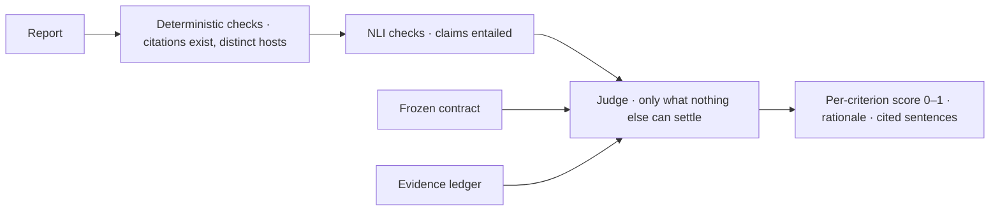




Many of the qualities we care about in an agent's output have no deterministic test: is the explanation accurate, are the trade-offs stated, is the tone right? People can judge these, but slowly. A language model can judge thousands of outputs in minutes.
The catch is that a judge is itself a model, with biases, drift and its own hallucinations.

These notes treat an LLM judge the way psychometrics treats any measuring instrument: something to be designed carefully, calibrated against trusted raters, and trusted only as far as it has been measured.

By the end of these notes you should be able to:
- name the four common judge biases and the design fix for each;
- compute Cohen's kappa and explain why raw agreement can mislead;
- apply reliability and validity to judge design, and write a rubric like a test;
- choose between pairwise and absolute judging, and design an independent auditor.



📘 **LLM-as-a-judge** means asking a model to decide something about another model's output: does it meet a criterion, is it faithful to its evidence, which of two answers is better?

| | |
|---|---|
| ✅ **Why: scalable** | Some qualities have no deterministic check ("_are the trade-offs stated?_", "_is the explanation accurate?_"). People can grade them, but slowly and expensively; a judge grades thousands in minutes. |
| ⚠️ **The catch: biased** | A judge is itself a model. It has biases, it drifts between versions, and it can [hallucinate]() too. |

Zheng et al. (MT-Bench, 2023) found that strong judges agree with human experts about **as often as experts agree with each other**, and in the same paper documented position, verbosity and self-preference biases.

**A judge is an instrument. Calibrate it before you trust its readings.**




| Bias | What it looks like | Design fix |
|---|---|---|
| ↔️ **Position** | In a pairwise comparison, prefers whichever answer it reads first (or second), regardless of quality | Ask twice with the **order swapped**; count only consistent preferences |
| 📜 **Verbosity** | Longer answers score higher | The rubric says length is not quality; compare at similar length |
| 🪞 **Self-preference** | Rates its own outputs (or its family's) higher | The judge is a **different model** from the author |
| 📊 **Leniency / central tendency** | Absolute scales bunch up: everything is a 7 or an 8 | Anchored rubrics, **binary** criteria, or pairwise comparison |

**Every bias has a design fix, not a prompt fix.** "_Please be unbiased_" in the prompt changes nothing; swapping order, changing the judge model and narrowing the question do.



How do you know whether a judge is any good? Compare its labels with a trusted rater's. But **raw agreement lies** on skewed labels.


100 claims. A human expert labels **90 supported, 10 unsupported**. A lazy judge says "_supported_" to **everything**.


- Observed agreement: **90%**. Looks great.
- But the judge learned nothing: it agrees 90% of the time **purely because** 90% of the labels are "_supported_".

Chance agreement for these label mixes:

\[p_e = P(\text{both supported}) + P(\text{both unsupported}) = 1.0 \times 0.9 + 0.0 \times 0.1 = 0.90\]

The judge's agreement is exactly what chance predicts. Its real skill is **zero**.

**On skewed labels, accuracy flatters. Kappa removes the luck.**



**Cohen's kappa** (Cohen, 1960) measures agreement between two raters, corrected for the agreement their label mixes would produce by chance:

\[\kappa = \frac{p_o - p_e}{1 - p_e}\]

- \(p_o\): **observed** agreement, the share of items both raters labelled the same.
- \(p_e\): **expected** agreement: for each label, (share the judge used it) × (share the rater used it), summed.

| \(\kappa\) | Meaning |
|---|---|
| 1 | Perfect agreement |
| 0 | No better than chance |
| < 0 | Worse than chance (systematic disagreement) |

**Worked example.** 100 claims. Judge: 85 supported, 15 unsupported. Human: 80 supported, 20 unsupported. They agree on 78 supported + 13 unsupported = 91.

\[p_o = 0.91 \qquad p_e = 0.85 \times 0.80 + 0.15 \times 0.20 = 0.71 \qquad \kappa = \frac{0.91 - 0.71}{1 - 0.71} \approx 0.69\]

And the lazy judge from the previous panel: \(\kappa = (0.90 - 0.90)/(1 - 0.90) = 0\).

**How much is enough?** The conventional reading (Landis & Koch, 1977), a convention rather than a law:

| \(\kappa\) | < 0 | 0.00–0.20 | 0.21–0.40 | 0.41–0.60 | 0.61–0.80 | 0.81–1.00 |
|---|---|---|---|---|---|---|
| Agreement | Poor | Slight | Fair | Moderate | **Substantial** | Almost perfect |

Our bar is **κ ≥ 0.6** (substantial) before a judge's verdicts gate anything.

Other fields work the same way. Radiologists reading the same scans are routinely reported at moderate-to-substantial kappa, which is why a second read exists.
Large-scale essay scoring pairs a human and an automated scorer and checks their agreement before the machine score counts (Williamson, Xi & Breyer, 2012).

**A judge needn't beat people. It must agree as well as people agree with each other.**

[Read more about Performance Metrics]()



**Psychometrics** is the science of measuring things you can't see directly (ability, attitudes) with instruments (tests, raters). An LLM judge is exactly such an instrument, and the field already has the vocabulary (AERA/APA/NCME _Standards_, 2014):

**Reliability: does it give the same reading twice?**
- **Test–retest**: the same item, judged again on another run or another day. Even at temperature 0, hosted models vary, so re-judge a sample.
- **Inter-rater**: does it agree with another rater? That's kappa.
- **Internal consistency**: do items meant to measure the same thing agree with each other?

**Validity: does it measure what you meant?**
- **Content**: does the rubric cover the construct? "_Accuracy_" that never looks at the evidence isn't accuracy.
- **Criterion**: does it agree with a trusted reference (human labels, or an independent check)?
- **Construct**: does it respond to the thing itself, not a proxy like length, confidence or politeness?

**A reliable judge can be reliably wrong. You need both.**

**Write the rubric like a test.** Most judge disagreement is a rubric problem, not a model problem:
1. 🪜 **Anchor every level**: a 1–10 scale without definitions is ten guesses. Define what each level looks like, and prefer fewer levels.
2. 🎯 **One construct per item**: "_accurate and well-written_" is two questions. Split them.
3. ✅ **Binary where you can**: "_Does the report state at least one trade-off?_" (yes/no) agrees far better than "_rate the trade-off discussion 1–10_".
4. 🧾 **Reason before verdict, and cite the evidence**: the rationale first, then the score, quoting the words that earned it.

[Read more about Hypothesis Testing]()



The oldest result in psychometrics: **Thurstone's law of comparative judgment** (1927). People are far more consistent saying **which of two** stimuli is heavier or better than assigning each an absolute number.
The same holds for models: "_rate this out of 10_" drifts between runs and between judges; "_which of these two is better?_" stays stable.

| | **Score it** (absolute) | **Compare it** (pairwise) |
|---|---|---|
| Needs | An internal scale held constant across items and runs | Only the two items in front of it |
| Stability | Drifts | Stable |
| Price | Leniency, central tendency | **Position bias** (judge twice, swapped); many pairs for n candidates |

**Chatbot Arena** (Chiang et al., 2024) ranks models from millions of pairwise human votes, fitted with a **Bradley–Terry** model (1952). MT-Bench showed pairwise judging by strong models tracks those human preferences.
For a pairwise win rate \(\hat{w}\) over \(n\) consistent comparisons, report its [binomial]() standard error so you can tell a real win from sample-size noise:

\[\text{SE} = \sqrt{\frac{\hat{w}(1-\hat{w})}{n}}\]

**So which do you use?**

| Use | When the question is | Example |
|---|---|---|
| **Pairwise** | Which variant is better? | Prompt A vs B; model X vs Y; before vs after a change |
| **Absolute, binary** | Does this output meet this criterion? | "_Trade-offs stated?_" as a gate |
| **Absolute, graded** | How much? (rarely) | Only with anchored levels |

**Rank variants pairwise. Gate a single output against a criterion.**

[Read more about Binomial Distribution]()  
[Read more about Confidence Interval]()



Every grader (eval metrics, rubric checks, agent judges) asks **one** judge client, so they all grade with the same model, fallback chain and rules:

| Setting | Value · why |
|---|---|
| **Model** | A larger model, **not one the agents write with** |
| **Backup** | A second model, so an answer always comes back |
| **Temperature** | 0: the same reading twice, as far as possible |
| **Validation** | [Pydantic, auto-repair](): a judge answers in schema, or it hasn't answered |
| **Bar** | κ ≥ 0.6 before its verdicts gate anything |

**Shared grading rules**, prepended to every judge; each line is a bias fix, written down once:
- "_Judge only from what you are shown. Never use outside knowledge._" → validity.
- "_Reason first, then decide._" → the rationale constrains the verdict.
- "_A pass must point at something real: quote the words._" → an auditable verdict.
- "_If what you are shown cannot settle the question, say so; that is a valid answer, and a guess is not._" → an honest third option.
- "_Length, confidence and politeness are not quality._" → verbosity bias, named.
- "_Answer with JSON only._" → schema validation.

**An outage is not a verdict.** If every model in the chain is down, or the answer fails its schema after the bounded repair, the judge **abstains**: the item is "_not judged_", never a pass and never a silent fail.

**A zero is a verdict; an outage is not. Never a silent zero.**



**Kappa in every eval run.** Two independent raters grade the same cases: the eval judge's faithfulness verdict (after the fact, reading the whole conversation) and the runtime [hallucination guard]() (local NLI, in the request path).
Neither is ground truth. The report line reads "_N cases · observed agreement x% · Cohen's κ y · k disagreements_", and the disagreements are where to look: where they disagree, one of them is wrong.

**κ says whether to trust either; disagreements say where to look.**

**The RA's independent auditor** is the most demanding judge use ([evaluator–optimizer]() in the run graph):

1. **Judge last**: deterministic and NLI checks run first. Only criteria nothing deterministic can settle (trade-offs stated, explanation accurate, the user's own criterion) go to the judge.
2. **Isolated**: it sees exactly three inputs (the frozen contract, the report, the evidence ledger), never the conversation or the run's reasoning.
3. **A different model**: the judge must resolve to a different model than the writer, **checked at start-up**; writers can't fall back onto the judge's model.
4. **Told it's independent**: "_You did not write this report and have no stake in it._"

**An auditor who read the author's drafts is not independent.**

**Why this design**: judge **last** (the most expensive, least reliable check), **measured** not trusted (κ on every eval run), **independent** by construction, and **abstain, never guess**.



Your pairwise judge says prompt B beats prompt A 70% of the time. With the order swapped, it says A beats B 65% of the time. What's going on, and what do you report?



Strong **position bias**: the judge mostly prefers whichever answer appears in one position, so the prompts are probably about equal.
Judge every pair **both ways**, count only **consistent** preferences as wins (inconsistent ones are ties), and report the win rate **with its standard error** so readers can see whether the difference exceeds sample noise.



- 🔭 **A judge is an instrument**: biased, drifting; calibrate before you trust it.
- 🎲 **Cohen's κ removes chance**: 90% agreement can be κ = 0. Our bar: 0.6.
- 📐 **Psychometrics**: reliability and validity; write the rubric like a test.
- ⚖️ **Rank pairwise, gate absolutely**; the RA's auditor is last, isolated and independent.

💡 _A judge that has never been measured against another rater is an opinion with a temperature setting._



- Zheng et al., [_Judging LLM-as-a-Judge with MT-Bench and Chatbot Arena_](https://arxiv.org/abs/2306.05685) NeurIPS (2023).
- Wang et al., [_Large Language Models are not Fair Evaluators_](https://arxiv.org/abs/2305.17926) (2023): position bias.
- Panickssery et al., [_LLM Evaluators Recognize and Favor Their Own Generations_](https://arxiv.org/abs/2404.13076) (2024).
- Cohen, [_A Coefficient of Agreement for Nominal Scales_](https://doi.org/10.1177/001316446002000104) (1960).
- Landis & Koch, [_The Measurement of Observer Agreement for Categorical Data_](https://doi.org/10.2307/2529310) Biometrics (1977).
- Williamson, Xi & Breyer, [_A Framework for Evaluation and Use of Automated Scoring_](https://doi.org/10.1111/j.1745-3992.2011.00223.x) EM:IP (2012).
- AERA, APA & NCME, [_Standards for Educational and Psychological Testing_](https://www.testingstandards.net/) (2014).
- Thurstone, [_A Law of Comparative Judgment_](https://doi.org/10.1037/h0070288) Psychological Review (1927).
- Chiang et al., [_Chatbot Arena: An Open Platform for Evaluating LLMs by Human Preference_](https://arxiv.org/abs/2403.04132) (2024).
- Bradley & Terry, [_Rank Analysis of Incomplete Block Designs_](https://doi.org/10.2307/2334029) Biometrika (1952).
- Liu et al., [_G-Eval: NLG Evaluation using GPT-4 with Better Human Alignment_](https://arxiv.org/abs/2303.16634) EMNLP (2023).


<!-- nav-panel:start -->

<a href="">Previous: Hallucination Checks</a>
<a href="">Next: Agent Security Principles</a>

<!-- nav-panel:end -->
