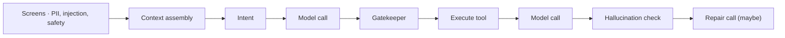
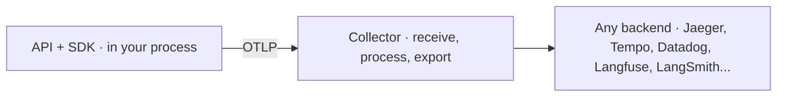
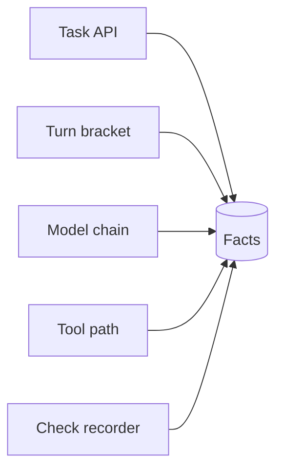
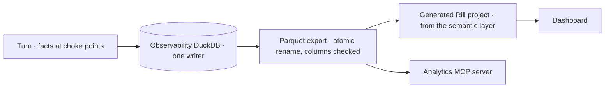




A non-deterministic agent cannot be reproduced; it can only be recorded. The same input may take a different path tomorrow, so if a turn was not recorded when it happened, it is gone.
**Observability** is the practice of recording enough, in the right shape, to answer three different questions: what happened in this turn, why it happened, and how the whole fleet is doing.

These notes build that practice around a single trace identifier, compare a homegrown design with the OpenTelemetry standard and its emerging conventions for generative AI, and describe analytics as a platform contract from which dashboards are generated.

By the end of these notes you should be able to:
- explain traces and spans, and why one identifier must join logs, facts, traces and audit records;
- compare a homegrown telemetry design with the OpenTelemetry GenAI conventions, and plan a migration;
- define fleet metrics once and generate dashboards from them;
- set rules for exporting traces safely to a third-party tool.



Run one customer turn and copy its **trace id**. Then:
1. Search the log files for that id: the whole turn appears, across every subsystem's file.
2. Open the same id in the tracing UI: the turn's run tree, with timings.
3. Open the dashboard: resolution rate, groundedness and fallback rate for the whole fleet.

**One id, three views**: what happened in this turn, why, and how the whole fleet is doing.



📘 One agent, three questions, three tools:

| Question | Tool | What it shows |
|---|---|---|
| 🔎 **What happened in _this_ turn?** | A **trace** | Every model call, tool, check, retry and fallback, in order, with timings |
| 🧾 **Why did it happen?** | The **logs** | Full structured detail from every subsystem: the authoritative record |
| 📈 **How is the fleet doing?** | **Analytics** | Aggregates over thousands of turns: resolution rate, groundedness, p95 latency |

**Monitoring** answers questions you knew to ask in advance. **Observability** lets you ask _new_ questions after the fact, which, for a non-deterministic agent, is most of them.

💡 **You can't reproduce a non-deterministic turn. You can only record it.**



A **trace** is one request's whole journey. It is made of **spans**, one per unit of work (an HTTP call, a database query, a model call), each with a start, an end, a **parent**, and attributes.
The **trace id** is shared by every span in it.

**W3C Trace Context** standardises how the id travels between services: the `traceparent` header carries a version, a **32-hex-character trace id**, a 16-hex span id, and flags.

📌 An e-commerce checkout touches the web tier, cart, pricing, payments, inventory and email. When checkout is slow, the trace shows which of six services spent the time.
**Without a shared id: six logs and a guess. With one: the slow span.**

**Agents need tracing more than ordinary services.** One customer turn can be:

Some calls retry; some fall back to a backup model; and **the same input may take a different path tomorrow**.
So the bar is: **every hop recorded, under one id, redacted before it's written.**



**One turn is one trace**: the agent binds a fresh 32-hex id when a turn starts, in the W3C shape.
It is **ambient**: context variables hold the agent, session, channel and trace id, so every log line any subsystem writes during the turn leads with them.
It is bound at turn start and **reset at turn end**, so a turn's identity never leaks into the next one.

An id is only as useful as the number of places it joins. Ours appears in four:

| Place | How |
|---|---|
| **Log lines** | Every line of the turn, in every subsystem's file |
| **Facts** | The turn's row, and every model call, tool proposal and check row of the turn |
| **Tracing UI** | The turn's root run id **is** the trace id |
| **Audit** | Audit entries and PII-vault rows carry it: "_who revealed what, during which turn_" joins too |

**Four records, four jobs**, joined by one id:

| Record | Holds | Answers |
|---|---|---|
| **Logs** | Everything, per subsystem, local | _Why did it happen?_ |
| **Spans** | Trace tree · latency · cost | _What happened, in what order?_ |
| **Facts** | Five grains, append-only | _How often, how fast, how much?_ |
| **Audit** | Every decision and its reason | _Who decided, on what authority?_ |

**Logging rules**: structured, one rotating file per subsystem (llm, tools, gatekeeper, memory, context, security, hallucination check...), written independently of any UI, and **redacted** before anything is exported.
Decorators log a call/return pair around functions; failures are **always re-raised**.

💡 **A tracer that hides an exception hides the one event worth tracing.**



**OpenTelemetry (OTel)** is a CNCF standard for telemetry: three signals (**traces, metrics, logs**), one data model, vendor-neutral.

- **Semantic conventions**: agreed attribute names, so every backend knows `http.response.status_code` is the status code.
- **GenAI semantic conventions**: the same for model calls, tools and agents: `gen_ai.*` attributes, and span names like `chat {model}`, `execute_tool {tool}`, `invoke_agent {agent}`.
  Status: **Development**, still changing (e.g. `gen_ai.system` was renamed `gen_ai.provider.name`).

**Where a homegrown stack typically stands**, attribute by attribute:

| OTel GenAI | Ours | Status |
|---|---|---|
| Trace id (W3C) | 32-hex trace id | ✅ Aligned |
| `gen_ai.provider.name` · `gen_ai.request.model` | Provider and model per attempt | Renamed |
| `gen_ai.usage.input_tokens` / `output_tokens` | Prompt / completion (+ cached) tokens | Renamed |
| `gen_ai.response.finish_reasons` | Finish reason | Renamed |
| `gen_ai.conversation.id` · `gen_ai.agent.id` | Session id · agent id | Renamed |
| `gen_ai.operation.name` · span names | Roles (answerer, planner) and tool stages | Different |
| Guardrails, retries, cost | Check rows, attempt numbers, cost | **Beyond the spec** |

💡 **Mostly the same data under our names; the gap is the wire, not the content.**

**The real gaps**, named precisely:

| Gap | Consequence |
|---|---|
| No OTel SDK, no OTLP | A collector can't ingest the telemetry as-is |
| No propagation | A subprocess (e.g. an [MCP server]() over stdio) isn't in the turn's trace |
| Metrics in SQL | No `gen_ai.client.token.usage` / `operation.duration` histograms |
| Content capture | Full payload kept locally; exported redacted |
| Span semantics | No span kind, no OTel status codes |

**Why it's that way**: local-first in one process (nothing to propagate across, until MCP); **facts beat spans for analytics** (grains, append-only rows, NULL-versus-zero semantics); a moving standard (emitting early means migrating twice).
And because every fact is written at **one choke point**, adding OTel is one adapter, not instrumentation scattered through the code.

**The path to OTel**:
1. An exporter at the four choke points: turn → `invoke_agent` span; model chain → `chat {model}` per attempt; tool path → `execute_tool {tool}`; check recorder → a span or event per check.
2. Map fields to `gen_ai.*` attributes (one table, in config).
3. Keep the trace id (already W3C-shaped).
4. Propagate `traceparent` into the MCP subprocess, in each request's `_meta` (stdio has no headers).
5. OTLP to a Collector, exporting to whatever backend the team uses.
6. **Keep the facts**: they remain the analytics contract.

💡 **Keep the facts for analytics; add spans for interoperability.**



Every agent gets the common metrics **without writing analytics code**. Facts are recorded only at platform **choke points the agent can't bypass**:

- **Five grains**: task event, turn, model attempt, tool proposal, check.
- **Common keys** on every fact, stamped from the bound context: agent, session, task, turn, step, channel, time.
- **Append-only**; schema changes are additive; a column is never repurposed.
- **NULL ≠ 0**: NULL means _not observed_ (the feature was off); 0 means _observed, and none happened_. Every formula ignores NULLs.
- Tiers: **1** the platform catalogue · **2** an agent's own tables and metrics · **3** eval scores ([Evals]()).

💡 **A new agent appears on the dashboard by running turns.**

**Metrics, defined once** (name, SQL, direction, default SLO target), read by dashboards, the analytics MCP server and an ops agent alike:

| Metric | Formula (sketch) | Better |
|---|---|---|
| `resolution_rate` | Successful ÷ terminal tasks | Higher |
| `groundedness` | Claims supported ÷ checked ([E09]()) | Higher |
| `hallucination_turn_rate` | Turns with an unsupported claim | Lower |
| `fallback_rate` | Attempts served by a backup model | Lower |
| `tool_call_validity` | Proposals that reached execution | Higher |
| `loop_abort_rate` | Turns that hit the step cap ([E06]()) | Lower |
| `block_rate` | Screened messages blocked, by check ([E11]()) | Context |
| `tokens_per_resolved_task` | Tokens of resolved ÷ resolved tasks | Lower |

💡 **A formula written twice drifts. Write it once, in the semantic layer.**



**Rill** is an open-source, BI-as-code dashboard tool built on DuckDB: models are SQL, metric views are YAML, dashboards are files, so a dashboard is **reviewable and generated**, like code.

1. The agent appends facts to its own database (one writer, its own process).
2. **Export**: readers must not open a live database, so each curated view is rendered to Parquet, written to a temporary name and **renamed into place** (a reader never sees half a file). Columns are checked against the semantic layer on every export: an undocumented or vanished column fails the export, not a dashboard.
3. **Generate** the dashboard project from the semantic layer: one fleet page, plus a page per agent with its Tier-2 metrics.
4. **Serve**, and refresh by re-exporting.

💡 **Dashboards are generated, never hand-written: a hand-written measure is a second copy of a formula.**



**LangSmith** is LangChain's hosted platform for tracing, debugging and evaluating LLM apps: a trace is a tree of runs (chain, llm, tool...), **threads** group a conversation's traces, **projects** group an app's.

How we use it: **one root run per turn, whose id _is_ the turn's trace id**. Everything the turn causes nests under it (graph nodes, model calls, tool executions).
One project per agent; thread = session. Settings: off by default; a **sample rate** (lower in production); graph steps sent as **what changed**, not the whole state again.

**Two rules for every export**:
1. 🔐 **Nothing unredacted leaves the machine**: input and output hooks run the [PII redactor]() over every string of every run. The local log keeps the full payload.
2. 🛟 **Export never fails a turn**: a missing key, a dead endpoint, a rejected batch is logged, and the turn carries on.

💡 **The local trace is the record; the tracing UI is a view of it.**

**Which tool, which question**:

| Question | Tool |
|---|---|
| Why did this one turn refund the wrong order? | Logs (search the trace id), then the run tree |
| Which model call was slow in this turn? | Run tree · spans |
| Has groundedness dropped since Tuesday's deploy? | The dashboard |
| Ask the data a question in English | An ops agent over the [analytics MCP server]() |



Average latency looks fine, yet users say the assistant is "sometimes painfully slow". Where do you look, in which order?



Start at the **fleet view**: p95/p99 latency, `fallback_rate` and `loop_abort_rate` over time, to see when and for whom it got slow.
Then pick a slow turn and follow its **trace id**: the run tree shows which span dominates (a retry storm, a fallback model, a long tool call, extra loop iterations), and the **logs** for the same id explain why.



- 🆔 **One turn, one trace id**: W3C-shaped, on every log line, fact, run and audit row.
- 🧾 **Logs are the record**: per subsystem, structured, never swallowing a failure.
- 🔌 **OTel**: the same data under our names; the gaps are the wire and propagation.
- 📊 **Facts → Parquet → generated dashboards**; the tracing UI is a redacted view of a turn.

💡 _Record at choke points, and every view is one adapter away._


**Further reading**
- W3C, [_Trace Context_](https://www.w3.org/TR/trace-context/) Recommendation.
- OpenTelemetry, [_Traces and spans_](https://opentelemetry.io/docs/concepts/signals/traces/)
- OpenTelemetry, [_Semantic Conventions for Generative AI_](https://opentelemetry.io/docs/specs/semconv/gen-ai/)
- Rill Data, [_Rill_](https://www.rilldata.com/) BI-as-code dashboards on DuckDB.
- LangChain, [_LangSmith documentation_](https://docs.smith.langchain.com/)

<!-- nav-panel:start -->

<a href="">Previous: Evals</a>
<a href="">Next: Model Context Protocol</a>

<!-- nav-panel:end -->
