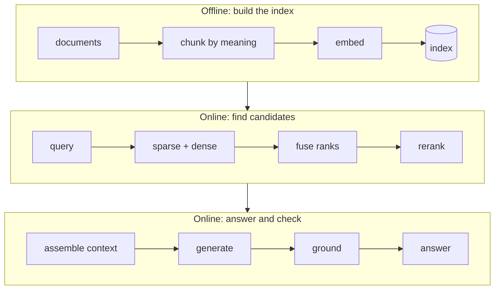
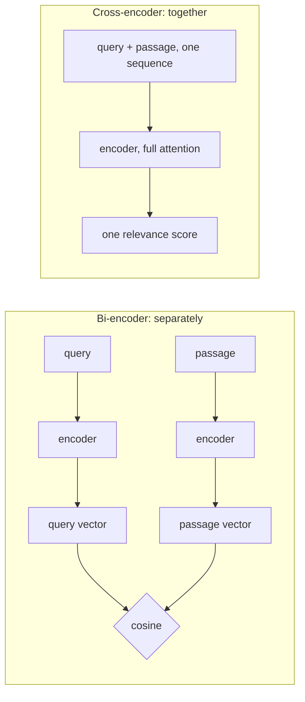
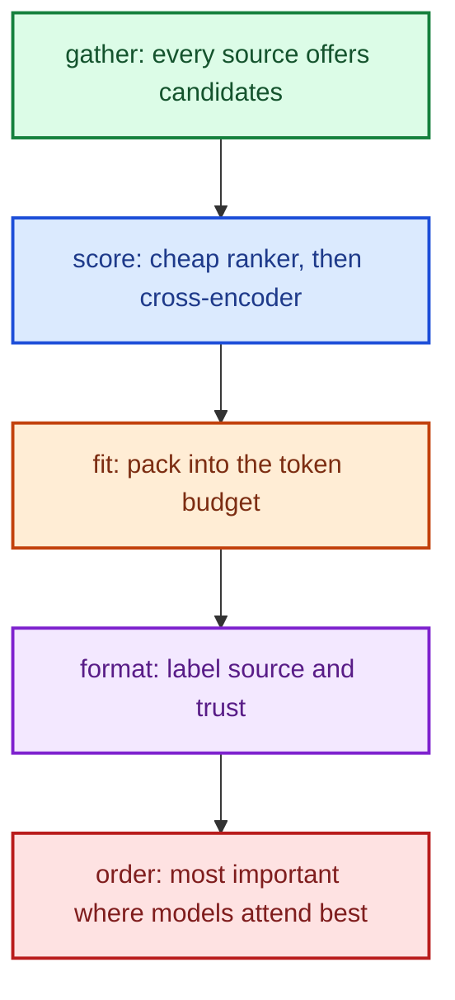
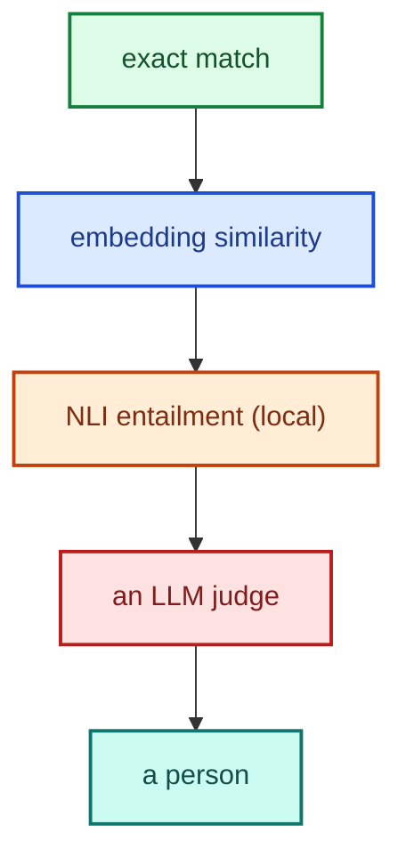




A language model knows a great deal about language and the world as it was during training, and nothing about your business: your refund policy, your product catalogue, last week's price change.
**Retrieval-Augmented Generation (RAG)** closes that gap by looking up relevant passages at query time and placing them in the model's context, so the answer is grounded in your data.

These notes treat RAG as an engineering pipeline of separately testable components rather than a single trick. We cover ingestion and chunking, sparse and dense retrieval, rank fusion, cross-encoder reranking, how retrieved text enters the context window, how answers are checked against it, and what should **never** be put in a retrieval index.

By the end of these notes you should be able to:
- explain the division of labour between a model's weights and a retrieval index;
- describe each stage of a production RAG pipeline and why it exists;
- explain why sparse and dense retrieval fail on different queries, and how rank fusion combines them;
- distinguish bi-encoders from cross-encoders, and justify a retrieve-then-rerank design by its cost;
- decide what knowledge belongs in an index and what must live elsewhere.



A customer asks the [support agent](): "_How long will my refund take to show on my card?_"

With the knowledge base switched on, the agent retrieves a passage from the help article `refunds.md`, under the heading _When the money arrives_, which says "_5 to 10 business days_". The answer quotes it, and a grounding check can verify every word against the passage.
With the knowledge base switched off, the agent has only the refund policy in its system prompt, which says nothing about bank timelines. Whatever it answers, it has nothing to ground it in, so it is either refusing or guessing.

The model is identical in both runs. What changed is a single **context source**. The model knows language; it does not know your business. RAG is how it looks your business up.



The paper that named RAG (Lewis et al., 2020) combined two kinds of memory.
**Parametric memory** is what a model learned into its weights during training. **Non-parametric memory** is an index the model can search at run time.

The two have very different properties. The weights are frozen when training ends: they cannot cite where a fact came from, cannot be updated for one business without retraining, and cannot forget a fact on request.
An index is updated by a sync, not a training run; every passage has a source that can be cited and checked; and it can be scoped to one customer and deleted.

The division of labour follows: use the **weights for language and reasoning**, and the **index for facts that belong to you**. Fine-tuning changes how a model behaves; RAG changes what it can look up.



Retrieval is much older than language models. Library and information science has been doing it since card catalogues, and Gerard Salton's **vector space model** (1975) is the direct ancestor of today's embedding search.
A good reference library gives you three ways to find something, and a good RAG system copies all three:

| In the library | What it does well | In RAG |
|---|---|---|
| The **card catalogue** | Finds exactly what you name (author, title, call number), but is useless if you don't know the word | **Sparse retrieval** (BM25) |
| The **reference librarian** | Understands what you _mean_: "_something on getting my money back_" leads to the refunds shelf | **Dense retrieval** (embeddings) |
| **Reading the shortlist** | Slow and careful, so you only do it for a handful of books | **Cross-encoder reranking** |

The catalogue finds, the librarian understands, and reading decides.




A production RAG system has two lanes. The **offline** lane prepares the index; the **online** lane answers a query.

Each box is a separate component that can be tested on its own, and each exists because the previous one has a characteristic weakness. The rest of these notes takes them in order.

**Ingestion, done carefully.** Three engineering choices in the offline lane matter more than they look:
- **Hash-skip sync.** Store a content hash per document and skip unchanged documents, so a restart makes no embedding calls and editing one article re-embeds only that article.
- **Semantic chunking** (next section).
- **A single embedding "fingerprint" per index.** Record which embedding model built the index, and **refuse** vectors from a different model.
  The worst RAG bug is silent: if two embedding models' vectors end up in one index, similarity scores become meaningless, and nothing errors.



Chunking decides what unit of text gets embedded, retrieved and shown to the model. If it is wrong, nothing downstream can recover.

The naive approach is **fixed-size** chunks: every N tokens, perhaps with some overlap. It is cheap, and blind. It cuts sentences mid-thought, and it separates a sentence from the heading that gave it meaning.

A better approach uses two signals, cheapest first:
1. **Structure.** Markdown headings are boundaries an author has already drawn. Split at headings, never let a chunk straddle two sections, and keep each chunk's **heading path**.
2. **Meaning.** Within a section, embed adjacent sentences and split where the topic shifts: where the distance between neighbouring sentences is unusually large (for example, above the 90th percentile of the gaps in that section).

Then enforce size bounds: fold fragments that are too short into a neighbour, and split runs that are too long at sentence boundaries.


In the support agent's help articles, the passage "_5 to 10 business days_" only answers the customer's question because it carries its heading path, `Refunds › When the money arrives`.
Stripped of its heading, the same sentence could be about delivery times, or anything else. A chunk without its heading is an answer without its question.




There are two families of retriever, and they fail on **different** queries, which is the whole case for using both.

**Sparse retrieval (BM25)** scores passages by exact term overlap, weighting rare terms more heavily and normalising for length. It descends from the Okapi system and [TF-IDF](). Its score for a query \(q\) and document \(d\) is

\[\text{BM25}(q, d) = \sum_{t \in q} \text{IDF}(t)\cdot\frac{f(t,d)\,(k_1 + 1)}{f(t,d) + k_1\left(1 - b + b\,\frac{|d|}{\text{avgdl}}\right)}\]

where \(f(t,d)\) is the count of term \(t\) in \(d\), \(|d|\) is the document length and avgdl the average length.
Two parameters fix TF-IDF's two flaws. \(k_1\) controls **saturation**: the tenth mention of a word adds much less than the first (a common default is 1.2; 1.5 lets a repeated error code count slightly more). \(b\) (typically 0.75) controls **length normalisation**, so a ten-page manual does not outrank a two-line ticket just because a word appears more often.
BM25 is excellent at identifiers (order numbers, SKUs, error codes) and poor at synonyms: a customer asking for "_money back_" will not match a passage that says "_refund_".

**Dense retrieval** embeds the query and each passage as vectors and returns the nearest neighbours by [cosine similarity]() (Karpukhin et al., 2020).
It handles paraphrase well ("_money back_" ≈ "_refund_") and is poor at exact identifiers: "_10023_" and "_10032_" sit very close together in vector space.
A useful refinement is **asymmetric** embedding, in which queries and passages are embedded with different instructions, because questions and answers don't look alike.

Because each fails where the other succeeds, a production system runs **both** and combines the results.

[Read more about TF-IDF]()  
[Read more about Word2Vec]()  
[Read more about Cosine Similarity]()



How do you merge two ranked lists whose scores live on different scales? BM25 scores are unbounded, \([0, \infty)\); cosine similarities lie in \([-1, 1]\).
If you simply add them, whichever scale happens to be larger wins, for reasons that have nothing to do with relevance, and normalising them is fragile.

**Reciprocal Rank Fusion** (Cormack, Clarke & Büttcher, 2009) sidesteps the problem by ignoring scores entirely and using only **ranks**:

\[\text{RRF}(d) = \sum_{r \in \text{retrievers}} \frac{1}{k + \text{rank}_r(d)}, \qquad k = 60\]

**Worked example.** Suppose passage A is ranked 1st by BM25 and 30th by the dense retriever, and passage B is ranked 5th by both. Then
\(\text{RRF}(A) = \frac{1}{61} + \frac{1}{90} \approx 0.0275\) and \(\text{RRF}(B) = \frac{1}{65} + \frac{1}{65} \approx 0.0308\).
B wins: a passage both retrievers rank decently beats a passage only one of them loves. That is exactly the behaviour we want from hybrid retrieval.

A typical configuration takes the top 20 from each retriever, fuses them, and passes a shortlist of about 10 to the next stage.

**Don't compare scores from different models. Compare ranks.**



The single most important architectural distinction in retrieval is between two ways of using a transformer encoder.

A **bi-encoder** ([Sentence-BERT](); Reimers & Gurevych, 2019) encodes the query and each passage **separately**. Because a passage never needs to see the query, every passage can be encoded once, offline, and stored.
At query time you encode only the query and run a fast vector search. This scales to millions of passages.

A **cross-encoder** encodes the query and passage **together** as one sequence, `[CLS] query [SEP] passage`, so every query token [attends]() to every passage token, as in [BERT](). It sees the interactions a bi-encoder misses: negation, which entity, which number.
It is much more accurate at judging relevance (Nogueira & Cho showed this decisively on the MS MARCO benchmark in 2019), but nothing can be precomputed: every query–passage pair is a fresh forward pass.

**The arithmetic.** Assume, for illustration, about 5 ms per pair for a small cross-encoder on a CPU. Reranking 10 candidates costs about 50 ms, which is fine.
Cross-encoding a corpus of a million passages would cost about 5,000 seconds, roughly **1.4 hours per question**. That is why every production system **retrieves broadly with a bi-encoder (and BM25), then reranks a small shortlist** with a cross-encoder.

**The encoder family.** The same idea, small specialised encoders for narrow jobs with the large model kept for language, appears throughout the course's agents.
Bi-encoders handle retrieval and chunk boundaries; cross-encoders handle relevance (the reranker) and **entailment** (the NLI model behind [hallucination checks]());
sequence classifiers route intents; token classifiers find personal data for the [PII filter]().

**Bi-encoders recall from millions. Cross-encoders decide among ten.**

[Read more about BERT]()  
[Read more about Sentence-BERT]()  
[Read more about Self-Attention]()



A retrieved passage is not automatically shown to the model. It is a **candidate**, competing for space in the context window with everything else: the customer's orders, working memory, recalled facts.
A context pipeline decides what the model actually sees:

Two details matter. First, every chunk is labelled with its **source and a trust class** (system › verified › retrieved › user › model). A knowledge-base passage enters as _retrieved_: it is **evidence, never an instruction**.
So a sentence inside an article that says "_ignore your rules_" stays inert text ([prompt injection]()).
Second, **position** matters: models read the start and end of a long context better than the middle. We study this pipeline in depth in [Context Management]().



Retrieval is only half the job. The other half is proving that the answer **stayed inside** what was retrieved. A model given the right passage can still embellish it, misread a number, or answer from its weights instead.

The course's agents check each claim in the drafted reply using a cascade that resolves claims **cheapest first**:

Most claims are settled in the first tiers, for free. A claim the passages do not support is cut, and the reply is referred to a person.
This is where the **heading paths** from chunking pay off again: "_according to our refunds article_" becomes verifiable rather than decorative. The full method is in [Hallucination Checks]().

**Retrieval finds the evidence. Grounding proves the answer stayed inside it.**



Where does RAG fit in an agent's overall memory? Cognitive psychology (Tulving, 1972) splits long-term memory into **episodic** (what happened) and **semantic** (what is generally true). The CoALA framework (Sumers et al., 2023) carried that taxonomy into language agents:

| Memory | Holds | Example |
|---|---|---|
| **Working** | The current conversation | The last few turns |
| **Episodic** | What happened | Past sessions |
| **Semantic** | What is generally true | Facts, and **the knowledge base (RAG)** |
| **Procedural** | How to do things | Skills and instructions |

In this view, **RAG is the read path of semantic memory**. The support agent's help articles are a good fit for an index precisely because they are **general** (the same answer for every customer, so nothing personal can leak), **authored** (written by people and rarely changed), and **citable** (every passage keeps its heading path).

An honest note: the agent's corpus today is only four articles, which would fit in the prompt. It is still retrieved, because the context window is shared with orders, memory and history, and because the design must hold at four hundred articles, not four.
We return to the other memories in [Memory Management]().



Deciding what **not** to retrieve is as important as deciding what to retrieve. Retrieval is a ranking, and rankings can miss things. Some knowledge must never be missed, and some must never be shared.

| Knowledge | Where it lives instead | Why |
|---|---|---|
| **The refund policy** | The system prompt, every turn, never trimmed | Ranking can miss a passage; the policy must never be missed |
| **The rules themselves** (the $50 limit, eligibility) | Code: the Gatekeeper and the tools | Rules must be certified, not retrieved ([Levels of Automation]()); articles only explain them |
| **The customer's orders** | A small corpus rebuilt per request, from that verified customer's orders only | A shared index over every customer's orders is one ranking bug away from a data leak |
| **Facts about a customer** | A keyed store: exact lookup first | Keyed, versioned and erasable on request |
| **Help articles** | The RAG knowledge base | General, long-tail, citable |

**Retrieve what can be ranked. Never rank what must never be missed.**



Pulling the chapter together, here are six common ways RAG fails in production and the guard for each. It is also a useful checklist to put to any vendor.

| Failure | Guard |
|---|---|
| The wrong chunk is retrieved | Hybrid retrieval, cross-encoder reranking, and heading paths |
| The index is stale | Content-hash sync |
| Two vector spaces are mixed | An index fingerprint that refuses vectors from a different model |
| A document contains instructions | Trust class "retrieved": evidence, never instruction |
| Another customer's data appears | A corpus scoped to the verified customer, rebuilt per request |
| The answer goes beyond the evidence | NLI grounding: cut the claim, refer the reply |



Users complain that the assistant "can't find" answers about specific error codes like `E-4012`, even though the documentation contains them. What is the likely cause, and what would you change?



Dense embeddings are weak at exact identifiers, so a purely vector-based retriever tends to miss them. Add **BM25** alongside dense retrieval, fuse the two by **rank (RRF)**, and **rerank** the shortlist with a cross-encoder.
Also inspect the chunks: the error code and its explanation may have been split into different chunks, or lost the heading that says what they refer to.



- Use the **weights for language** and the **index for facts that belong to you**.
- Sparse (BM25) and dense retrieval **fail on different queries**; run both and **fuse by rank**, not by score.
- **Bi-encoders recall** cheaply from millions of passages; **cross-encoders decide** accurately among a shortlist.
- Retrieved text is **evidence, not instruction**, and the answer must be **grounded** against it.
- RAG is the **read path of semantic memory**; policies, rules and per-customer data belong elsewhere.

_Retrieve what can be ranked. Never rank what must never be missed._



- Lewis et al., [_Retrieval-Augmented Generation for Knowledge-Intensive NLP Tasks_](https://arxiv.org/abs/2005.11401), NeurIPS (2020): the paper that named RAG.
- Salton, Wong & Yang, [_A Vector Space Model for Automatic Indexing_](https://doi.org/10.1145/361219.361220), Communications of the ACM (1975).
- Robertson & Zaragoza, [_The Probabilistic Relevance Framework: BM25 and Beyond_](https://doi.org/10.1561/1500000019) (2009).
- Karpukhin et al., [_Dense Passage Retrieval for Open-Domain Question Answering_](https://arxiv.org/abs/2004.04906), EMNLP (2020).
- Cormack, Clarke & Büttcher, [_Reciprocal Rank Fusion outperforms Condorcet and individual Rank Learning Methods_](https://doi.org/10.1145/1571941.1572114), SIGIR (2009).
- Reimers & Gurevych, [_Sentence-BERT_](https://arxiv.org/abs/1908.10084), EMNLP (2019): bi-encoders for semantic search.
- Nogueira & Cho, [_Passage Re-ranking with BERT_](https://arxiv.org/abs/1901.04085) (2019): cross-encoder reranking.
- Sumers et al., [_Cognitive Architectures for Language Agents (CoALA)_](https://arxiv.org/abs/2309.02427) (2023); Tulving, [_Episodic and Semantic Memory_](https://psycnet.apa.org/record/1973-08477-007) (1972).
- See also, in this site's NLP course: [Text Embeddings]() and [BERT]().


<!-- nav-panel:start -->

<a href="">Previous: Agentic Design Patterns</a>
<a href="">Next: Guardrails, Loop Control & State</a>

<!-- nav-panel:end -->
