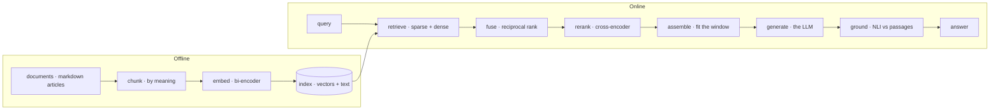
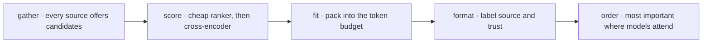
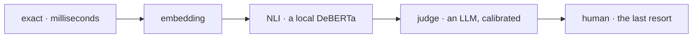




A customer asks the [customer support agent](): "_How long will my refund take to show on my card?_"

| | Semantic memory **on** | Semantic memory **off** |
|---|---|---|
| Context | A retrieved passage: `refunds.md › When the money arrives` | Only the refund policy in the prompt |
| Answer | "5 to 10 business days", grounded and verifiable | Nothing to ground a timeline in |

What changed? Not the model. Not the prompt. **One context source: the knowledge base.**

👉 **The model knows language. It doesn't know your business.** RAG is how it looks your business up.



📘 The paper that named RAG (Lewis et al., 2020) combined two kinds of memory:

| | **Parametric** · the weights | **Non-parametric** · the index |
|---|---|---|
| Updated by | A training run; frozen afterwards | A sync |
| Can cite its source? | No | **Yes**, every passage has one |
| Per business / deletable? | No | **Scoped and deletable** |
| Use it for | **Language and reasoning** | **Facts that belong to you** |

💡 **Language from the weights. Facts from the index.**



Library science has done retrieval since card catalogues (Salton's vector space model, 1975, is the ancestor of every embedding search). A good library gives you three ways in, and RAG copies all three:

| In the library | What it does | In RAG |
|---|---|---|
| 🗂️ **The card catalogue** | Exact terms, titles, call numbers | **Sparse retrieval** (BM25) |
| 🧑‍🏫 **The reference librarian** | Understands what you _mean_ | **Dense retrieval** (embeddings) |
| 📖 **Reading the shortlist** | Slow, careful, only for a handful | **Cross-encoder reranking** |

💡 **Catalogue to find, librarian to understand, reading to decide.**



Seven components, each separately testable.



**Ingestion, done carefully** (the offline lane):
- 🔁 **Hash-skip sync**: an unchanged document is skipped; a warm start makes **zero** embedding calls.
- ✂️ **Semantic chunks**: split by heading, then where the meaning shifts; 40 to 300 tokens each.
- 🧬 **One fingerprint**: the index records which embedding model built it. Vectors from a different model are **refused, never mixed**.

💡 The worst RAG bug is silent: **two vector spaces in one index** gives similarity scores that mean nothing. Refuse it at write time.



Chunking decides what the model can be shown. Get it wrong and nothing downstream recovers.

| **Fixed-size** | **Semantic** (ours) |
|---|---|
| Every N tokens, with some overlap | 1. Split at **headings**; keep the heading path |
| Cuts mid-thought; loses the heading that gave a sentence its meaning | 2. Inside a section, split where adjacent sentences **diverge** (cosine distance above the 90th percentile of that section's gaps) |
| Cheap, and blind | Fragments < 40 tokens fold into a neighbour; runs > 300 split at sentence boundaries |

📌 "_5 to 10 business days_" only answers the question because its passage carries `Refunds › When the money arrives`.

💡 **A chunk without its heading is an answer without its question.**



| | **Sparse · BM25** | **Dense · bi-encoder** |
|---|---|---|
| Matches | Exact terms, weighted by rarity | Meaning, as vectors; nearest by cosine |
| Finds | Order 10023, SKUs, error codes | "money back" ≈ "refund" |
| Misses | "money back" vs "refund" | 10023 vs 10032 |
| Ours | k1 = 1.5 · b = 0.75 · top 20 | Asymmetric query/passage embeddings · top 20 |

💡 **They fail on different queries. That's why you run both.**

**BM25** builds on TF-IDF and fixes two flaws: linear growth in word counts, and length bias.

\[\text{BM25}(q, d) = \sum_{t \in q} \text{IDF}(t)\cdot\frac{f(t,d)\,(k_1 + 1)}{f(t,d) + k_1\left(1 - b + b\,\frac{|d|}{\text{avgdl}}\right)}\]

- \(k_1 = 1.5\) (term-frequency saturation; textbook default 1.2): a repeated error code or part number can push relevance a little higher.
- \(b = 0.75\) (length penalty): a 10-page manual doesn't outrank a 2-line ticket just because the word appears more often overall.

[Read more about Text Embeddings]()



How do you combine two ranked lists whose scores live on different scales? BM25 is unbounded \([0, \infty)\); cosine is \([-1, 1]\). **Add them and the bigger scale wins, not the better passage.**

**RRF** (Cormack, Clarke & Büttcher, SIGIR 2009) ignores scores and fuses **ranks**:

\[\text{RRF}(d) = \sum_{r \in \text{retrievers}} \frac{1}{k + \text{rank}_r(d)}, \qquad k = 60\]

A passage both legs agree on rises to the top. Ours: sparse top 20 + dense top 20 → RRF → a **shortlist of 10** for the reranker.

💡 **Don't compare scores from different models. Compare ranks.**



```mermaid
graph LR
    subgraph Bi-encoder · separately
    Q1[query] --> E1[encoder] --> QV[query vector]
    P1[passage] --> E2[encoder] --> PV[passage vector]
    QV --> COS{cosine}
    PV --> COS
    end
    subgraph Cross-encoder · together
    QP["query + passage · one sequence"] --> E3["encoder · full attention"] --> S["relevance · one score"]
    end
```

| | **Bi-encoder** | **Cross-encoder** |
|---|---|---|
| Input | Query and passage encoded **separately** | `[CLS] query [SEP] passage` **together** |
| Precompute | Passages encoded once, offline | Nothing can be precomputed |
| Per query | 1 pass + a vector search | 1 pass **per candidate**; cost grows with length² |
| Sees | Overall similarity | Interactions: negation, which entity, which number |
| Scale | Millions | A shortlist |

**The arithmetic** (illustrative, ~5 ms a pair; measure your own): 10 candidates ≈ 50 ms; 1M passages ≈ **1.4 hours** per question.
Ours: a small MiniLM-L6 cross-encoder, local, over a shortlist of 10, skipped below 3 candidates.

💡 **Bi-encoders recall from millions. Cross-encoders decide among ten.**

**The encoder family**: small encoders do the narrow jobs; the LLM is kept for language (the "NOLLM" principle):
bi-encoders (retrieval, chunk breakpoints, intent by nearest examples), cross-encoders for relevance (reranker) and for **entailment** (NLI grounding),
sequence classifiers (intent routing), token classifiers (NER for the [PII filter]()) and safety classifiers (the injection screen).

[Read more about BERT]()



Passages are **candidates**; the context pipeline decides what the model actually sees.



**Trust classes**, highest first: `system › verified › retrieved › user › model`.
A knowledge-base passage enters as **retrieved**: it is **evidence, never an instruction**, so a sentence in an article that says "_ignore your rules_" stays text.

👉 The knowledge base is one candidate source. The pipeline decides what fits.

[Read more about Context Management]()



Retrieval is only half the job; the other half is proving the answer **stayed inside** what was retrieved.

The scoring cascade resolves each claim **cheapest tier first**:



In the CSA, the hallucination guard runs this on every drafted reply: **a claim the passages don't support is cut, and the reply is referred to a person.**

💡 **Retrieval finds the evidence. Grounding proves the answer stayed inside it.**

[Read more about Hallucination Checks]()



Four kinds of memory, from cognitive psychology (Tulving, 1972) to language agents (CoALA, 2023):

| Memory | Holds | Ours |
|---|---|---|
| **Working** | The conversation now | Last 6 turns |
| **Episodic** | What happened | Past turns and sessions |
| **Semantic** | What is generally true | Facts + **the knowledge base (RAG)** |
| **Procedural** | How to do things | Skills, curated lessons |

💡 **RAG is the read path of semantic memory.**

Why the CSA's help articles fit an index: they are **general** (same answer for every customer, nothing personal to leak), **authored** (change rarely; hash-skip sync), and **citable** (every passage keeps its heading path).
Four articles today, built for four hundred: the context window is shared.

[Read more about Memory Management]()



| Knowledge | Where it lives | Why |
|---|---|---|
| **Refund policy** | System prompt, every turn | Ranking can miss it; it must never be missed |
| **The rules** | Code: Gatekeeper, tools | Must be certified ([E02]()) |
| **Customer's orders** | Per-customer corpus, rebuilt per request | No shared index, no cross-customer leak |
| **Facts about a customer** | Keyed store: exact lookup → BM25 | Keyed, versioned, erasable |
| **Help articles** | RAG knowledge base | General, long-tail, citable |

💡 **Retrieve what can be ranked. Never rank what must never be missed.**



| Failure | Guard |
|---|---|
| Wrong chunk retrieved | Hybrid legs + cross-encoder rerank + heading paths |
| Stale index | Content-hash sync at start-up |
| Mixed vector spaces | Index fingerprint refuses a different model |
| Instructions inside a document | Trust class "retrieved": evidence, never instruction ([Agent Security]()) |
| Another customer's data | Corpus scoped to the verified customer, per request |
| Answer beyond the evidence | NLI grounding: cut and refer |

👉 Ask any RAG vendor to fill in the right-hand column.



Users complain the bot "can't find" answers about specific error codes like `E-4012`, though the docs contain them. What is the likely fix?



Dense embeddings are weak at exact identifiers. Run **BM25 alongside dense retrieval**, fuse the two by **rank (RRF)**, and rerank the shortlist with a **cross-encoder**.
Also check chunking: the error code and its explanation may have been split apart, or lost their heading path.



- 🧠 **Weights for language, the index for facts that belong to you.**
- 🔀 **Sparse and dense fail differently**; fuse them by rank.
- 🎯 **Bi-encoders recall, cross-encoders decide**, on a shortlist.
- 🗃️ **RAG is semantic memory's read path**: facts + the knowledge base.

💡 _Retrieve what can be ranked. Never rank what must never be missed._


_Reference_:
- Lewis et al., Retrieval-Augmented Generation for Knowledge-Intensive NLP Tasks, NeurIPS 2020, https://arxiv.org/abs/2005.11401
- Salton, Wong & Yang, A Vector Space Model for Automatic Indexing, Communications of the ACM, 1975, https://doi.org/10.1145/361219.361220
- Robertson & Zaragoza, The Probabilistic Relevance Framework: BM25 and Beyond, 2009, https://doi.org/10.1561/1500000019
- Karpukhin et al., Dense Passage Retrieval for Open-Domain Question Answering, EMNLP 2020, https://arxiv.org/abs/2004.04906
- Cormack, Clarke & Büttcher, Reciprocal Rank Fusion, SIGIR 2009, https://doi.org/10.1145/1571941.1572114
- Reimers & Gurevych, Sentence-BERT, EMNLP 2019, https://arxiv.org/abs/1908.10084
- Nogueira & Cho, Passage Re-ranking with BERT, 2019, https://arxiv.org/abs/1901.04085
- Sumers et al., Cognitive Architectures for Language Agents (CoALA), 2023, https://arxiv.org/abs/2309.02427
- Tulving, Episodic and Semantic Memory, 1972

<!-- nav-panel:start -->
<div style="display:flex;justify-content:space-between;align-items:center;width:100%;gap:16px;">
<span><a href="">Previous: Agentic Design Patterns</a></span>
<span style="margin-left:auto;"><a href="">Next: Guardrails, Loop Control & State</a></span>
</div>
<!-- nav-panel:end -->
