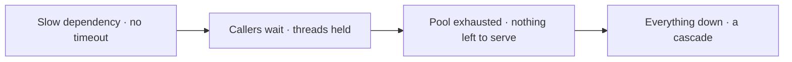
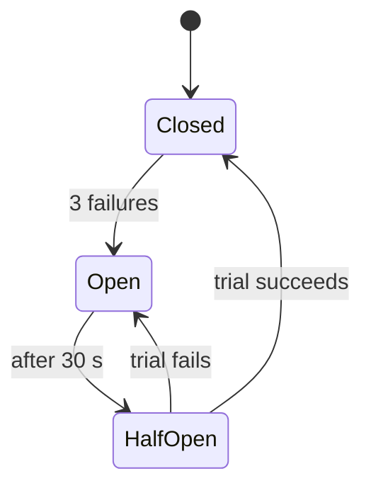
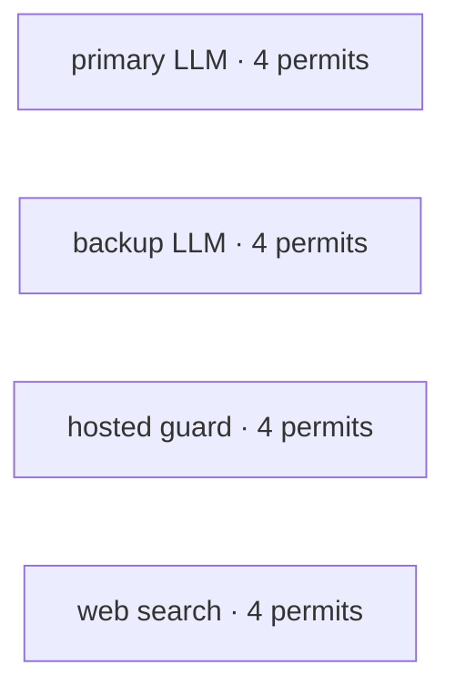
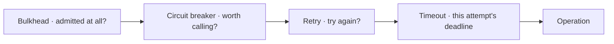




The model is the least reliable component of an agent, and it is surrounded by networks, quotas and databases that fail too. A single turn may make twenty calls; if each succeeds 99% of the time, one turn in five meets a failure somewhere.
At scale, failure is not an exception to handle occasionally; it is the normal case to design for.

These notes take the stability patterns from Michael Nygard's _Release It!_ (timeouts, retries, circuit breakers, bulkheads), add idempotency and sagas for actions that must never happen twice or half-way, and show how the order in which the patterns are composed is itself the design.

By the end of these notes you should be able to:
- explain with Little's law why an unbounded wait can take down a whole system;
- design retries with jittered backoff, and know when not to retry;
- use circuit breakers and bulkheads to contain a failing dependency;
- make side effects idempotent and multi-step changes compensable with sagas.



A customer asks the [CSA]() to refund a $30.95 T-shirt (under the limit). The executor's trace shows an **idempotency key** for the call, and the **saga** steps that issue the refund.
Then the customer asks again: "_Refund order 10535._" It **does not pay twice**: the order is already refunded, and a retried call under the same key **replays its first result**.

Press **Stop** while a refund runs and the stop report shows the saga **compensated** what had committed: nothing is half-applied.
And if a backup model answered any call, the trace says which, and why.

👉 The model is the least reliable thing in this system, and it's surrounded by networks, quotas and databases that fail too.



📘 **Resilience** is a system's ability to keep delivering acceptable service when its dependencies fail or slow down. Agents are more fragile than a typical web request, for three reasons:

1. 🕸️ **Many dependencies per turn**: screens, a safety model, an intent model, the main model two or three times, tools, the database, the grounding check. Each is a network call that can be slow, throttled or down.
2. ✖️ **Reliability multiplies**: in series, the whole succeeds only if every part does:

\[R_{\text{turn}} = \prod_{i=1}^{n} r_i \qquad 0.99^{20} \approx 0.82\]

   20 calls at 99% each means **one turn in five** hits a failure somewhere.
3. 🔁 **Duplicates by nature**: a model re-proposes a call after a timeout, a [resumed run]() re-executes a node, a customer types "_refund it!_" twice. Without protection, each is a second payment.

**Failures aren't exceptions. At scale they are the normal case; design for them.**



The intellectual source for these notes is Michael Nygard's _Release It!_ (2007; 2nd ed. 2018). Its central argument: integration points are the number-one killer in production;
a failure in one place **cracks** into others (cascading failures); and **the worst failure is not the error but the hang**.



> "_The dangerous failure is not the call that errors; it is the call that never returns. An unbounded wait converts a slow dependency into an exhausted thread pool, and then into an outage of everything sharing it._"

**One pattern per failure**:

| Pattern | Protects against | In one line |
|---|---|---|
| ⏱️ **Timeout** | A call that never returns | Bound every wait |
| 🔁 **Retry** | A transient failure | Try again, carefully |
| 🔌 **Circuit breaker** | A dependency that's down | Stop calling; fail fast |
| 🚢 **Bulkhead** | One failure starving the rest | Separate pools |
| 🔑 **Idempotency** | A duplicate request | Same key, same result |
| ↩️ **Saga** | A half-applied change | Undo in reverse |
| 🧩 Hedge · rate limit · dead-letter queue | Slowness · quotas · bad input | Supporting patterns |

**Name the failure first; the pattern follows from it.**



**Timeout**: give every remote call a deadline; past it, stop waiting and fail with an error the caller can handle.


A checkout page waits on a fraud-scoring service with no deadline. The fraud service gets **slow** (not down, slow). Every checkout holds a worker while it waits; within minutes no worker is free, and the whole store is down because of one slow dependency.


**Why hangs kill: Little's law** (Little, 1961). The average number of requests in a system \(L\) equals the arrival rate \(\lambda\) times the average time each spends inside \(W\):

\[L = \lambda \cdot W\]

| | \(\lambda\) | \(W\) | In flight \(L\) |
|---|---|---|---|
| Normal | 50/s | 0.2 s | **10** |
| Dependency hangs | 50/s | 30 s | **1,500**: a pool of 100 is gone in 2 s |

A timeout caps \(W\), and therefore caps everything waiting behind it.

⚠️ Two subtleties: the timeout bounds **each attempt** (so retries still get their chance), and time spent **queued for a rate-limit slot** doesn't count against it.
Otherwise a throttled call times out, is retried, queues again, and times out again.



Most failures in a distributed system are **transient**: a connection reset, a brief overload, a rate limit. Trying again often works, if you wait longer each time (**exponential backoff**).


A phone app's photo upload fails on a weak signal; it retries after 1 s, 2 s, 4 s, and succeeds once the signal returns.


**Two borrowed ideas**:
- **Exponential backoff** comes from **Ethernet** (Metcalfe & Boggs, 1976): stations that collide wait a random slot from a window that doubles after each collision.
- **Jitter**: Marc Brooker's AWS analysis (2015) showed plain exponential backoff still synchronises clients: everyone who failed together retries together, in waves. **Full jitter** picks a random delay below the capped exponential:

```python
delay = random.uniform(0, min(max_delay, base_delay * 2 ** (attempt - 1)))   # full jitter
# ours: base 0.2 s · cap 2.0 s · 3 attempts
```

**Jitter is not a refinement: it's what stops the retry storm** that keeps a recovering service down.

**When _not_ to retry**:

| Don't retry | Because |
|---|---|
| An **open circuit** | The breaker already decided it's down; retrying only burns the budget |
| **Quota exhausted** | The provider said no; trying again changes nothing |
| **Validation errors (4xx)** | A malformed request fails the same way every time |
| **No idempotency key** | A retry is a duplicate by construction, so it is **refused outright** |



Borrowed from electrical engineering: a breaker **trips** when current is dangerous, protecting the wiring downstream, and is reset to test whether the fault has cleared.



- **Closed**: calls flow; failures are counted.
- **Open**: calls fail fast without touching the dependency.
- **Half-open**: after a cooldown, **one** trial call is let through.


A store's recommendations service fails repeatedly. The page stops calling it and shows bestsellers, so product pages stay fast, until a trial call succeeds again.


**Implemented as an explicit state machine**: only the legal transitions above are allowed; anything else is a bug and is rejected.
**Which errors count is a decision**: a timeout-only breaker trips on silence, not on prompt errors, because "_a dependency returning errors is answering_", and tripping on those would hide a bug behind an outage.

⚠️ **One breaker per dependency**: a shared breaker couples unrelated failures.



Borrowed from shipbuilding: a hull divided by watertight bulkheads floods **one compartment, not the vessel**.
Give each dependency its own limited pool of capacity, so one can't use up everyone's.


An airline site gives fare search and payment separate worker pools. A fare-search spike (a sale, a bot) saturates the search pool; payments still have capacity.




Each model, each search provider and each hosted guard gets its **own** pool (4 permits by default). "_Pools are separate objects rather than one shared counter: that separation is the isolation._"
By default a caller **queues**; with a wait budget it is **rejected** instead: shedding load is a choice the caller makes, not a default.

⚠️ A single global concurrency limit looks like protection but isn't: one stalled dependency takes every permit.



From algebra: an operation is **idempotent** when applying it twice equals applying it once:

\[f(f(x)) = f(x)\]

Setting a value is idempotent; adding to it is not. In systems, a request is idempotent when repeating it has no further effect.
The technique is an **idempotency key**: the server records the first result under the key, and returns it for any repeat.

- 💳 **Payments**: Stripe accepts an `Idempotency-Key` header; a retried charge returns the first result instead of charging twice.
- 🛗 **Lift button**: pressed five times, the lift comes once.
- 🔑 **Key design**: key the **intent** (this refund, of this order, for this amount), not the **attempt**. A random key per attempt protects nothing.

**Four sources of duplicates in an agent**: retries (the stack re-sends a timed-out call) · the model (it re-proposes the same tool call) · resume (a re-run node) · the person ("_Refund it!_" ... "_Refund it!_").

**In an agent, duplicates are the default, not an edge case.**

**Our keys**:

```text
exec:process_refund:<sha256(agent, actor, action, params)[:24]>   # executor: side-effecting calls only
refund:<order_id>:<cents>                                          # the refund itself
```

A durable, per-agent guard runs a call **once** and replays its recorded result afterwards, surviving restarts. When a refund is voided before it settles, its key is **forgotten**: the effect was reversed, so the next identical request is a new one.

**Remember what happened; forget it when it's undone.**



**Sagas** (Garcia-Molina & Salem, 1987): split a long operation into local transactions \(T_1 \dots T_n\), each with a compensating transaction \(C_1 \dots C_n\). If \(T_k\) fails, run \(C_{k-1} \dots C_1\) **in reverse**.



No distributed transaction spans an airline, a hotel chain and a car-rental firm. Book in order; if the car fails, cancel the hotel, then the flight.


⚠️ Compensation is a **semantic undo** (a cancellation, a reversal), not a database rollback; it can fail too, and must be recorded for a person. **Put irreversible steps last.**

**The CSA's refund saga**: issuing a refund touches two things that can't share a transaction (the order's refund state and the refund ledger).

| Step | Does | Compensation |
|---|---|---|
| 1 · `mark_refund_issued` | A **conditional update**: succeeds only if the order is still refundable and totals exactly this amount | Restore the previous status |
| 2 · `record_payment` | Write the ledger entry, under the executor's key | Reverse the payment |
| _(not a step)_ | Notify the customer | **Waits for settlement**: it's the one thing that can't be undone |

A conditional update replaced a re-read because, unlike a read, it can't go stale before the write.

**The shared skeleton**: precondition → idempotency replay → run steps (compensate on failure) → **remember successes only** (a remembered failure would make a transient fault permanent for that key).
A failing compensation is recorded and the unwinding **continues**. A **Stop** is a failure too: the saga compensates (shielded so the same Stop can't cut the undo short), then lets the cancellation through.

**A saga's promise isn't "all succeed"; it's "never half-applied".**



Every call to a dependency goes through one fixed stack, **outermost first**:



Get the order wrong and the layers fight: "_a timeout outside retry cuts off the retries instead of the call, and a breaker inside retry counts one logical call as three failures and trips at a third of the intended threshold._"
And **one stack per dependency**: the breaker's count and the bulkhead's permits are per-dependency state.

**Timeout inside retry; breaker outside it.**

**Hedging the model.** "_A slow dependency is a worse failure than a dead one_": a dead one fails fast; a slow one holds the caller for its whole timeout and then usually fails anyway.
From Dean & Barroso's _The Tail at Scale_ (2013): start the primary at once; if it hasn't finished after a hedge delay, or as soon as it fails, start a backup **beside** it; the first success wins and the rest are cancelled.
Each model has its own full stack; the chain decides which model answers, and each attempt is recorded ([fallback rate]()).

**Rate limits** are spent by **attempts**, not logical calls (an SDK retry and a stack retry each cost one), so the limiter applies per HTTP attempt, as a sliding window per provider, shared across processes. A call's clocks run from **admission**, so throttling doesn't cascade into timeouts.

**Dead-letter queue**: named after the postal dead-letter office. A request blocked by [security screening]() gets a durable destination (the review queue) for a person to decide, and is **never** re-run automatically. Otherwise a detector merely logs a warning while the workflow continues.

**Where it's applied**:

| Dependency | Protection |
|---|---|
| Every model | Bulkhead · breaker · retry · timeout + hedged backups |
| Hosted guards | Own stack each · fallback chain · fail closed |
| Web search and fetch | Own stack per provider · rate-limit buckets |
| Tool execution | Idempotency key · deadline |
| Refunds and cancellations | Sagas · durable keys |
| Blocked messages | Dead-letter queue → review |

Turn-level [budgets and deadlines]() sit above all of this. **No agent composes resilience itself: it's built once, in the platform.**



During a provider incident, agent workers retry aggressively; when the provider recovers, the traffic immediately trips its rate limits again. What went wrong?



A **retry storm**: retries without **jitter** (so clients retry in synchronised waves), without a **circuit breaker** (so calls kept hammering a dead dependency instead of failing fast or hedging to a backup), and without per-dependency **bulkheads** and **rate limiting per attempt**.
Fix: full-jitter backoff with a cap, a breaker per dependency, retries counted against the quota, and refuse retries of side-effecting calls that carry no idempotency key.



- ⏱️ **Bound every wait** (Little's law); retry with jitter, never without a key.
- 🔌 **Breakers and bulkheads** stop one failing dependency from taking the rest.
- 🔑 **Idempotency keys the intent**; sagas undo in reverse, irreversible steps last.
- 🧱 **One fixed order**: bulkhead → breaker → retry → timeout, one stack per dependency.

💡 _The dangerous failure is not the call that errors; it's the call that never returns._



Concepts used in these notes are developed in the other courses on this site:

- Maths: [Binomial Distribution]()
- Maths: [Central Limit Theorem]()
- NLP: [Large Language Models]()



- Nygard, [_Release It! Design and Deploy Production-Ready Software, 2nd ed._](https://pragprog.com/titles/mnee2/release-it-second-edition/) (2018).
- Little, [_A Proof for the Queuing Formula L = λW_](https://doi.org/10.1287/opre.9.3.383) Operations Research (1961); see also [Little's law](https://en.wikipedia.org/wiki/Little%27s_law).
- Metcalfe & Boggs, [_Ethernet: Distributed Packet Switching for Local Computer Networks_](https://doi.org/10.1145/360248.360253) CACM (1976).
- Brooker, [_Exponential Backoff and Jitter_](https://aws.amazon.com/blogs/architecture/exponential-backoff-and-jitter/) AWS Architecture Blog (2015).
- Stripe, [_Idempotent requests_](https://docs.stripe.com/api/idempotent_requests) API reference.
- Garcia-Molina & Salem, [_Sagas_](https://doi.org/10.1145/38713.38742) SIGMOD (1987).
- Dean & Barroso, [_The Tail at Scale_](https://doi.org/10.1145/2408776.2408794) CACM (2013).


<!-- nav-panel:start -->
<div style="display:flex;justify-content:space-between;align-items:center;width:100%;gap:16px;">
<span><a href="">Previous: Model Context Protocol</a></span>
<span style="margin-left:auto;"><a href="">Next: Economics: Build vs Buy</a></span>
</div>
<!-- nav-panel:end -->
