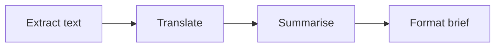
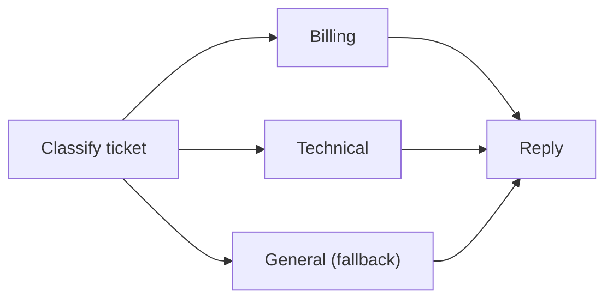
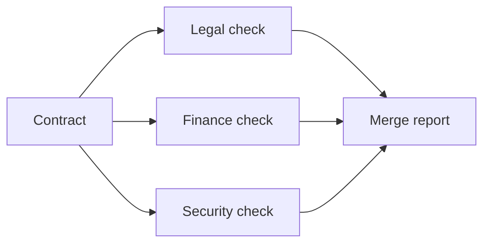
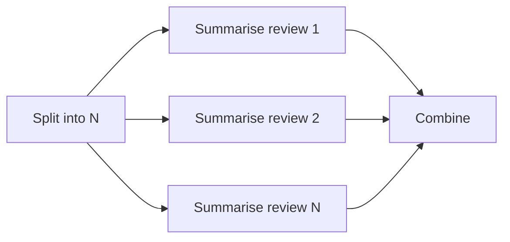
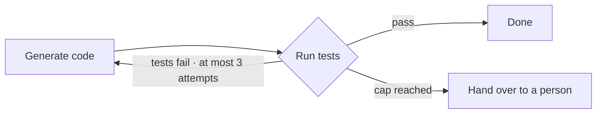
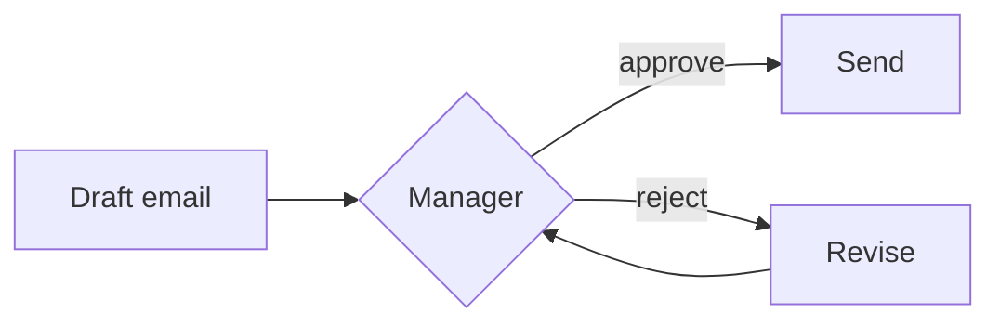
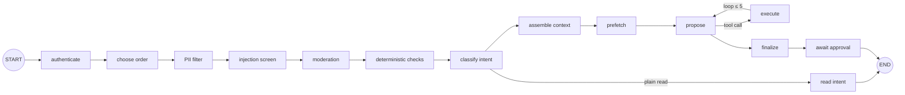
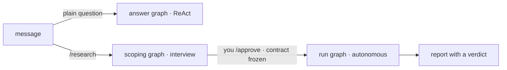




📘 One distinction organises this episode and the next: **who decides the next step, code or model?**

| | **Workflow** (this episode) | **Agent** ([next episode]()) |
|---|---|---|
| Path | Written **before** the run | **Emerges** at run time from the model's choices |
| Models | May work **inside** a step; never pick the next one | Choose the next step |
| Properties | Predictable, testable, cheap | Flexible, open-ended, harder to certify |

Ties to [Levels of Automation](): low cardinality → workflow; high cardinality with bounded blast radius → let the model choose.

💡 **Most production systems are mostly workflow. That's the design, not a compromise.**



| # | Pattern | Example |
|---|---|---|
| 1 | **Sequential pipeline** | Document intake: extract → translate → summarise → format |
| 2 | **Conditional branching** | Support ticket routed to billing / technical / general |
| 3 | **Parallel fan-out / fan-in** | Contract: legal, finance, security checks at once |
| 4 | **Map-reduce** | Summarise 500 product reviews, then combine |
| 5 | **Iterative loop (fixed N)** | Generate code, run tests, at most 3 attempts |
| 6 | **Human-in-the-loop** | Model drafts a marketing email; a manager approves |

👉 In every one, **you could print the graph before the run**.

_Two that look alike_: fan-out/fan-in has a **fixed** number of branches you can see on the diagram; map-reduce has **N** branches, decided at run time by the data.



Each step's output is the next step's input, in a fixed order.

- 📌 **Example**: document intake. A parser extracts the text, a model call translates it, another summarises it, a template formats the brief. A model works inside two steps; **none chooses what comes next**.
- ✅ **Use when**: the task splits into fixed stages, each simpler and testable on its own.
- ⚠️ **Watch out**: latency adds up, and an early mistake flows downstream. **Validate between steps**: if extraction returned nothing, stop instead of paying three model calls to summarise an empty page.



Code inspects the input and picks **exactly one branch from a closed set** (also called routing).

- 📌 **Example**: a support ticket is classified (keyword rules, then a small classifier) and routed. Anything the classifier isn't confident about goes to the **general queue**, not to a guess.
- ✅ **Use when**: inputs fall into known classes that need different handling.
- ⚠️ **Watch out**: misroutes become your error budget. **Always keep a fallback branch**, and watch its volume to know when the classes need updating.



A **fixed** set of independent branches run at the same time, then join.

- 📌 **Example**: contract review; three reviewers, always the same three.
- ✅ **Use when**: branches are independent and latency matters. Latency drops to the **slowest** branch instead of the sum.
- ⚠️ **Watch out**: **define the join**. Wait for all, or the first? If security times out: a partial report with a flag, or fail the whole thing? Handle branch failures and mind rate limits.



The **same step over N items**, where N is known only at run time, then one aggregation.

- 📌 **Example**: summarise every product review in parallel (map), then combine into one report (reduce). 5 reviews today, 500 tomorrow.
- ✅ **Use when**: N depends on the data and the items are independent.
- ⚠️ **Watch out**: **bound N and concurrency**, or one big input becomes one big bill. Test the reduce step hardest: it's where contradictions between items get silently averaged away.



Repeat a step until a check passes, **at most N times. The cap is set in code.**

- 📌 **Example**: generate a function, run the test suite, feed failures back, at most three attempts. On the third failure, **escalate with the failing tests attached**.
- ✅ **Use when**: generate-and-check work where a retry with feedback usually succeeds.
- ⚠️ **Watch out**: no cap means runaway cost. Good loops also detect "**no progress**": the same failure twice in a row is a reason to stop early.

💡 What makes this a _workflow_ loop: the stopping rule is code. The model writes the code inside the step; it doesn't decide whether to go round again (that's [agentic patterns]()).



The run **pauses, saves its state, and resumes** when a person decides. This is [level 5]() as a workflow shape.

- 📌 **Example**: a model drafts a campaign email; a manager approves (it's sent) or rejects with a note (it's revised and comes back).
- ✅ **Use when**: an approval or an answer is needed before an action that matters.
- ⚠️ **Watch out**: the pause must survive restarts (**checkpoint**): the approval may arrive in five minutes or five days, after a deploy or a crash.
  And keep what reaches people small, or the [ironies of automation]() set in.



| Pattern | Where in our code | Why there |
|---|---|---|
| **Sequential** | CSA front door · RA scope → contract → run | Order is safety: redact PII **before** hosted screens see the text |
| **Branching** | CSA intent → read · RA `/research` vs plain question · RA replies | Cheap answers skip the model |
| **Fan-out / fan-in** | RA research batches · **not** CSA screens | Speed in RA; privacy order wins in CSA |
| **Map-reduce** | RA sub-questions → synthesize | N depends on the question; capped |
| **Fixed-N loop** | CSA tool loop ≤ 5 · RA rounds, steps | Cost and runaway protection |
| **Human-in-the-loop** | CSA refund > $50 · RA contract approval | Level 5, checkpointed |

**CSA graph**: fifteen nodes, and only one lets the model choose the next step.

1. **Sequential pipeline**: PII → injection → moderation → deterministic checks → intent → context.
2. **Branching**: classify intent sends a plain read to _read intent_, with no model call.
3. **Fixed-N loop**: propose ⇄ execute, capped at 5. Whether to go round again is the model's call (that's [E04]()), but **the cap is code**.
4. **Human wait**: _await approval_, only when a refund was queued.

**RA graphs**: the router between the research agent's three graphs is **code**.

Inside the run graph, **the model fills the steps; code decides where the run goes next**:
map-reduce with fan-out/fan-in over sub-questions, fixed-N loops (research rounds, gap-fill rounds), and branching after an [LLM-judge audit]() (gap fill → revise → finalize).

👉 A scope is a conversation; a run is a job.



An "AI agent" classifies a document, extracts fields, validates them against a schema, and asks a human when validation fails. Is it an agent?



**No, it's a workflow**: a sequential pipeline with a branch and a human-in-the-loop step. Code picks every next step; models only work inside steps.
That's a good thing: it's predictable, testable and cheap.



- ✍️ **Workflow = code picks the next step.** Models may still work inside a step.
- 🧩 **Six shapes**: pipeline, branching, fan-out, map-reduce, fixed-N loop, human-in-the-loop.
- 🎧 **CSA is mostly workflow**: one model-driven loop in fifteen nodes.
- 🔎 **RA branches, maps and stops by code**; the model fills the steps.

💡 _Before you call it an agent, draw the graph. If code picks every next step, it's a workflow, and that's usually what you want._


_Reference_:
- Building Effective Agents, Anthropic, Dec 2024, https://www.anthropic.com/research/building-effective-agents
- LangGraph documentation, https://langchain-ai.github.io/langgraph/

<!-- nav-panel:start -->

<a href="">Previous: Levels of Automation</a>
<a href="">Next: Agentic Design Patterns</a>

<!-- nav-panel:end -->
