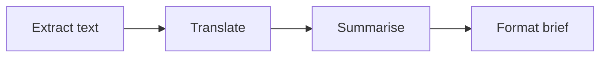
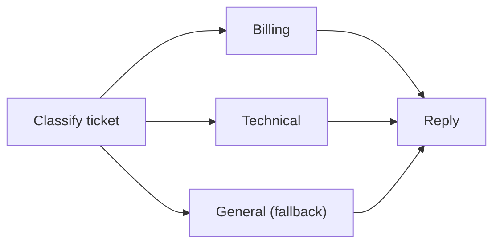
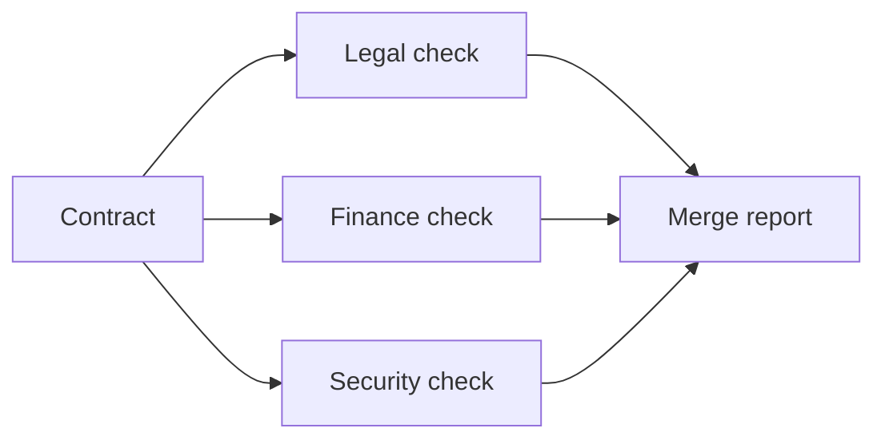
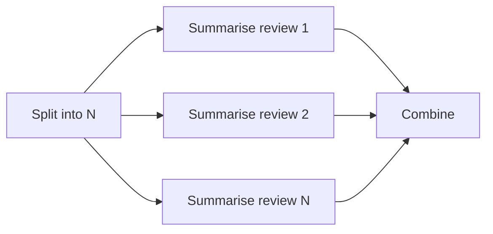
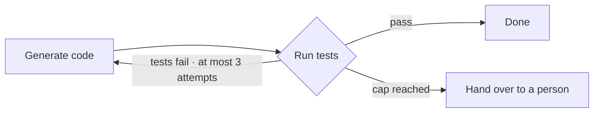
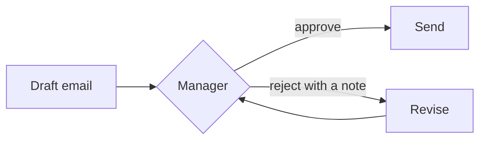
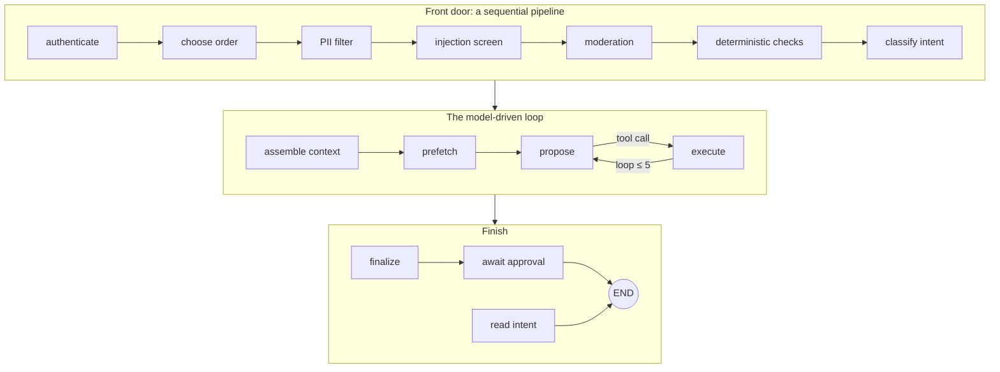
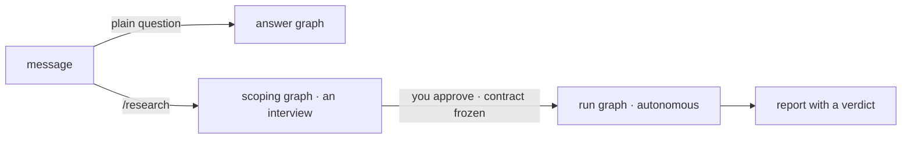




A surprising amount of what is marketed as "agentic AI" is, structurally, a **workflow**: a sequence of steps fixed in code, in which a language model does some of the work but never decides what happens next.
That is not a criticism. Workflows are predictable, testable and cheap, and most production systems should be mostly workflow.

These notes introduce the one distinction that organises this chapter and the next, **who decides the next step**, and then catalogue six workflow patterns.
For each we give a concrete example, when to use it, and the failure it invites. We finish by locating the patterns inside the course's two reference agents.

By the end of these notes you should be able to:
- tell a workflow from an agent by asking who chooses the next step;
- recognise and draw the six workflow patterns, and choose between them;
- name the characteristic failure of each pattern and the guard against it;
- read a real agent's graph and identify which parts are workflow and which are agentic.



In every agentic system, something decides what happens after each step. There are only two candidates.

In a **workflow**, **code** decides. The path is written down before the run starts: you could print the graph in advance. A model may do work _inside_ a step (summarise this, classify that), but it never chooses which step comes next.
In an **agent**, the **model** decides. The path emerges at run time from the model's choices, so you cannot know in advance how many steps a run will take or in what order. That is the subject of [Agentic Design Patterns]().

| | **Workflow** | **Agent** |
|---|---|---|
| Who picks the next step | Code | The model |
| When the path is known | Before the run | Only at run time |
| Properties | Predictable, testable, cheap | Flexible, open-ended, harder to certify |

The choice between them follows directly from the [three questions]() of the previous notes. Low cardinality (the situations can be enumerated) points to a workflow.
High cardinality with a bounded blast radius is where it pays to let the model choose.

**Most production systems are mostly workflow. That is the design, not a compromise.**




The simplest and most common pattern: each step's output is the next step's input, in a fixed order.


A document-intake system receives a PDF in another language. A parser extracts the text, one model call translates it, another summarises it, and a template formats the brief.
The order never changes. Models work inside two of the four steps, but none of them chooses what comes next.


**When to use it.** When a task splits naturally into fixed stages, each simpler than the whole. Smaller steps are easier for a model to do well, and each link can be unit-tested and replayed on its own.

**What goes wrong.** Latency adds up across steps, and an early mistake flows downstream: a bad extraction produces a confident summary of nothing.
The guard is a cheap **validation between steps**. If extraction returned an empty page, stop there instead of paying for two model calls to translate and summarise it.



Code inspects the input and picks **exactly one branch from a closed set**. This pattern is also called **routing**.


A support ticket is classified, first by keyword rules and then by a small classifier, and routed to billing, technical support or a general queue. Anything the classifier is not confident about goes to the general queue rather than to a guess.


**When to use it.** When inputs fall into known classes that need genuinely different handling: different prompts, different tools, even different models (a small, cheap model for easy questions and a large one for hard ones).

**What goes wrong.** Every misroute is a silent failure, so the **misroute rate becomes your error budget**. Always keep a **fallback branch**, and watch its volume: when it grows, your classes need updating.
Note that a classifier may well be a model, but it is still a workflow: the classifier produces a _label_, and code maps the label to a branch.

[Read more about Binary Classification]()



A **fixed** set of independent branches runs at the same time, and their results are joined.


A contract goes to three reviewers at once (legal, finance and security), and a merge step combines their findings into one report. It is always the same three, so the branches are visible on the diagram.


**When to use it.** When the branches do not depend on each other's output and latency matters. Running them together cuts the latency to that of the **slowest** branch rather than the sum.

**What goes wrong.** The interesting design lives in the **join**. Does the report wait for all three branches, or the first? If the security check times out, do you publish a partial report with a flag, or fail the whole thing?
These questions must be answered explicitly. Parallel calls also hit provider rate limits sooner ([Resilience]()).



The **same step over N items**, where N is known only at run time, followed by one aggregation.


Summarise every product review for a product, in parallel (the _map_), then combine the summaries into one report (the _reduce_). There might be 5 reviews today and 500 tomorrow.


This looks like fan-out, with one important difference: the number of branches is **not on the diagram**. It comes from the data at run time.

**What goes wrong.** Two things. First, **bound N and the concurrency**, or one large input becomes one large bill. Second, test the **reduce** step hardest: it is where contradictions between items get silently averaged away.



Repeat a step until a check passes, **at most N times**, with the cap set in code.


A model generates a function; the test suite runs; the failures are fed back; the model tries again, at most three times. On the third failure, the system escalates to a person **with the failing tests attached**, instead of looping forever.


**Why this is still a workflow.** The stopping rule is code: "_tests pass, or three attempts_". The model writes the code inside the step, but it does not decide whether to go round again. In the next chapter, it does.

**What goes wrong.** A loop without a cap is a runaway bill. Good loops also detect **no progress**: the same failure twice in a row is a reason to stop early. We formalise this as [loop control]().



The run **pauses, saves its state, and resumes** when a person decides. This is [level 5]() of the automation scale, expressed as a workflow shape.


A model drafts a marketing email. A manager approves it, and it is sent, or rejects it with a note, and it is revised and comes back.


**When to use it.** Whenever an approval or an answer is needed before an action that matters.

**What goes wrong.** The pause must be **durable**: the approval may arrive in five minutes or five days, after a deployment or a crash, and the run must resume exactly where it stopped.
That requires checkpointing the run's state ([state management]()).
And keep what reaches people small: if everything goes to a person, nobody really reviews anything ([the ironies of automation]()).



Patterns are easiest to understand in a real system. Here is where each one appears in the course's two reference agents, and why it is there.

| Pattern | Where it appears | Why there |
|---|---|---|
| **Sequential** | The CSA's front door; the RA's scope → contract → run | Order is safety: personal data is redacted **before** any hosted screen sees the text |
| **Branching** | The CSA routes a plain status question to a database read; the RA routes `/research` vs a plain question | Cheap answers skip the model entirely |
| **Fan-out / fan-in** | The RA's research batches; deliberately **not** the CSA's screens | Speed in the RA; in the CSA, the privacy order wins over speed |
| **Map-reduce** | The RA's sub-questions, then synthesis | N depends on the question, and is capped |
| **Fixed-N loop** | The CSA's tool loop (≤ 5); the RA's research rounds | Cost and runaway protection |
| **Human-in-the-loop** | CSA refunds over $50; the RA's contract approval | Level 5, checkpointed |

**The support agent's graph.** Compiled with every feature on, the CSA has fifteen nodes, and only one of them lets the model choose the next step:

Read it as four workflow patterns. The screens from PII filtering to context assembly form a **sequential pipeline**. _Classify intent_ **branches** a plain read away with no model call.
_Propose ⇄ execute_ is a **loop capped at 5** (whether to go round again is the model's choice, but the cap is code). And _await approval_ is a **human-in-the-loop** step, reached only when a refund was escalated.

**The research agent's graphs.** The RA has three graphs, and the router between them is code: a plain question goes to a direct-answer graph; a `/research` request goes to a scoping interview, which ends when you approve a frozen contract; the run graph then researches autonomously and returns a report.

Inside the run graph, a model fills the steps but **code decides where the run goes next**: map-reduce over sub-questions, capped research and gap-filling loops, and a branch after an [independent audit]() (gap fill, revise, or finalize).
A scope is a conversation; a run is a job.




An "AI agent" classifies a document, extracts its fields, validates them against a schema, and asks a human when validation fails. Is it an agent?



**No, it is a workflow**: a sequential pipeline with a branch and a human-in-the-loop step. Code picks every next step; models only work inside steps.
That is a good thing. It is predictable, testable and cheap, and it should only become agentic if some step genuinely needs the model to choose what to do next.



- A **workflow** is a system in which **code picks the next step**; models may still work inside steps. An **agent** lets the model pick.
- Six workflow shapes cover most needs: **pipeline, branching, fan-out, map-reduce, capped loop, human-in-the-loop**. Each has a characteristic failure and guard.
- The support agent is **mostly workflow**: one model-driven loop in fifteen nodes. The research agent branches, maps and stops by code; the model fills the steps.

💡 _Before you call it an agent, draw the graph. If code picks every next step, it's a workflow, and that's usually what you want._



- Anthropic, [_Building Effective Agents_](https://www.anthropic.com/research/building-effective-agents) (2024): a catalogue of workflow patterns and when to prefer them over agents.
- LangGraph, [_Documentation_](https://langchain-ai.github.io/langgraph/): the graph runtime used for the reference agents, including branching, fan-out and checkpoints.
- LangGraph, [_Persistence_](https://langchain-ai.github.io/langgraph/concepts/persistence/): how durable pauses for human-in-the-loop steps work.


<!-- nav-panel:start -->

<a href="">Previous: Levels of Automation</a>
<a href="">Next: Agentic Design Patterns</a>

<!-- nav-panel:end -->
